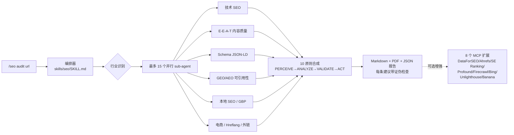

# AgriciDaniel/claude-seo

[GitHub URL](https://github.com/AgriciDaniel/claude-seo)


## claude-seo 深度评测：把 SEO 团队装进 Claude Code 的开源 Agent 体系

> 一个把整支 SEO 审计团队塞进 Claude Code 的开源插件，一条命令 10-15 分钟完成原本数小时的外包级网站审计。

- **Tags**: Claude Code, SEO 审计, 开源项目, AI Agent, GEO/AEO
- **Category**: 开发工具, AI 编程, SEO 营销

## Details

# 深度评测：claude-seo — 把整个 SEO 团队塞进 Claude Code 的开源尝试
## 一句话总结
**claude-seo 是目前 GitHub 上最完整的一套面向 Claude Code 的 SEO Agent Skill 体系——它用 25 个子技能 + 18 个专家 Agent + 32 个斜杠命令，把一次原本要花数小时甚至上万元的外包级 SEO 审计，压缩成一条 `/seo audit <url>` 命令的 10–15 分钟并行执行，并且完全 MIT 开源、零订阅费。** 它不是又一个"AI 写 SEO 文章"的玩具，而是把 Google 自己的 Quality Rater Guidelines、AI Optimization Guide、Schema 弃用时间表等一手源当成"宪法"写进 prompt 的工程化项目——如果你同时懂 SEO 和 Claude Code，它有改变你工作方式的潜力；如果你只是被它的 17k Star 吸引来的小白，先读完这篇再决定要不要上车。
---
## 背景与痛点：为什么"SEO 审计"这件事急需被重做
传统 SEO 审计有三种典型玩法，每一种都有其结构性缺陷：
- **人工审计**：一名资深 SEO 顾问 4–8 小时/站点，输出一份"信息墙"式 PDF，结论一致性高度依赖分析师个人水平。
- **Agency 外包**：1–3 周交付周期，单次报价 2k–15k 美元，客户几乎无法验证每一条建议是怎么来的。
- **商业工具（Screaming Frog、Ahrefs、Semrush、Sitebulb）**：单月订阅 $99–$999，强项是抓取深度和专有外链索引，但**对 AI 搜索（AI Overviews、AI Mode、GEO）的规则更新普遍滞后 6–12 个月**——这正是 2024 年以来 SEO 最剧烈的范式变动。
而 2025–2026 年，Google 自己发布了两份关键文件把这场变动推向高潮：**September 2025 Quality Rater Guidelines（把 YMYL 扩展到政治与社会话题）** 和 **May 2026 AI Optimization Guide（明确"AEO/GEO 就是 SEO 的换皮，AI Overviews 与经典搜索共享排名系统"）**。这意味着市面上大量"AI 搜索优化秘籍"——比如 llms.txt 是排名杠杆、内容要为 AI 做 chunking、要专门为 AI 改写关键词——都被 Google 官方口径直接证伪。
claude-seo 的作者 Daniel Agrici 抓住的正是这个时间窗口：**用 Claude Code 的 Agent Skills 标准（Claude Code 1.0.33+ 引入的 plugin marketplace 机制），把 Google 一手源、可证伪的工作流、并行 Agent 调度打包成开源插件**，对标"取代 $5–10K/月的 agency 工作"。他在 GitHub 主页的自我定位是 "AI marketing systems architect"，除 claude-seo（~17k stars）之外还维护 claude-ads（~8.9k stars）、claude-blog（~2.1k stars）、Obsidian 第二大脑（~14.7k stars）等一整条 Claude Code 生产力产品线。第三方目录 agenticskills.io 给出的评价是"**the most comprehensive single-author SEO skill bundle in the ecosystem**"（生态中单人作者完成的最完整 SEO 技能包）。
值得一提的是，作者通过 claude-seo 引流运营着 Skool 上的 AI Marketing Hub（免费 4900+ 人）和 AI Marketing Hub Pro（付费社群，4.9 分 17 条评价）。也就是说，开源插件是"获客钩子"，付费社群和 Rankenstein 产品才是变现主战场——这一定位判断会影响你后面怎么用它的"开放度"。
---
## 核心亮点：它到底解决了什么别人解决不了的问题
### 亮点 1：把 SEO 从"工具调用"升级为"多 Agent 并行作战"
传统 SEO 工具是"点按钮 → 跑爬虫 → 看报表"的批处理范式。claude-seo 走的是完全不同的路——把它想象成**把一支 18 人的 SEO 特种部队塞进你的终端**：当你输入 `/seo audit https://example.com`，编排器会按行业自动识别（SaaS / Local / E-commerce / Publisher / Agency），然后**一次性派出最多 15 个专家 sub-agent 并行分析**——有人管技术 SEO，有人管 E-E-A-T 内容质量，有人管 Schema，有人管 AI 可引用性——最后由编排器通过"10 原则框架"合成一份带优先级的行动方案。
整个体系用一张图可以看清：

这种"Agent 编队"模式的真正价值不是快，而是**覆盖面的非相加性**：一个资深顾问很难同时精通 Schema 2026 弃用规则、GBP 弃用字段、EU 能效标签、IndexNow 提交、CrUX LCP 子指标分解、IPTC `TrainedAlgorithmicMedia` AI 图片标注——但 18 个各自专精的 Agent 可以。
### 亮点 2：每条建议都是"可证伪的"，这是它和所有竞品最本质的区别
README 里反复强调一个词——**falsifiable（可证伪）**。它输出的每一条建议都强制带四个字段：
1. 所依赖的**第一性原理观察**
2. 与其他建议的**依赖关系**
3. **"我们怎么知道这条建议失败了？"** 的检验方式
4. 一个可监控的**领先指标**
这在 SEO 行业几乎是个反常识设计——传统 audit 报告是"信息墙"，客户看完不知道该先做哪条、做完了怎么验证有效。claude-seo 把每条建议变成了一个**可被推翻的假设**，而不是"权威建议"。用一句比喻：传统报告像中医开方（"辨证施治，整体调理"），claude-seo 像循证医学（"这个药，机制是 X，与 Y 有相互作用，如果两周内指标 Z 没变，说明诊断错了"）。
方法论层面，它内置了一套 4 阶段 10 原则的思考框架：PERCEIVE（观察外/内/倾听）→ ANALYZE（第一性原理思考/横向连接/系统连接）→ VALIDATE（共情/接受）→ ACT（创作/增长）。这不是营销话术，在 skills/seo/references/thinking-framework.md 里是真的有实现。
### 亮点 3：对"AI 搜索"的姿态——反神话、贴一手源
这是这个项目最"反流量"也最有价值的地方。当前 SEO 圈关于 GEO/AEO 有三大流行说法：llms.txt 是排名杠杆、内容必须为 AI 做 chunking、要为 AI 单独改写关键词。claude-seo 在 `seo-geo` skill 里**直接用 Google 一手源证伪了这三个**。
它的实际评分维度包括：
- **可引用段落评分**（134–167 词自洽答案块最佳）
- 问题式标题层级
- 引用密度
- 结构化数据覆盖
- Wikipedia/Reddit/YouTube/LinkedIn 的实体存在度
并且明确把 FAQPage 的 rich result（2026-05-07 已被 Google 移除）、HowTo（2023-09 移除）、SpecialAnnouncement、ClaimReview 等标记为"deprecated 不推荐"。在大量付费工具还在推荐这些"过期 schema 类型"的当下，这种一手源对齐能力本身就是稀缺品。
### 亮点 4：真实的输出质量，不是 PPT 级别的花架子
README 直接贴出了对自家站点 rankenstein.pro/about 的 `/seo schema` 真实输出。值得注意的细节是：它发现了**页面上显示两位联合创始人，但 Schema 的 founder 字段只写了 Daniel Agrici 一人**，并把这标记为 Critical Issue（"content-schema mismatch that can confuse search engines"）。这是典型的"交叉比对 + 常识推理"型发现，纯爬虫工具很难做到——因为爬虫只能看 HTML，不会去把页面文本和 JSON-LD 做语义对照。
实际 PDF 报告规格：WeasyPrint 生成 A4 排版，matplotlib 200 DPI 图表，全站审计约 **32 页 A4**，含封面、目录、执行摘要、数据章节、建议、方法论。这个规格已经接近商业工具的交付物水平。
---
## 技术架构与上手指南：怎么用、用什么
### 上手门槛：先冷静评估你的前置条件
坦白说，这个工具的**前置门槛不低**，请先自检以下三条：
| 前置项 | 是否必需 | 说明 |
|---|---|---|
| Claude Code CLI 1.0.33+ | 必需 | 这是插件的基础运行时，意味着你必须有 Claude 订阅（Pro/Max）或 API key |
| Python 3.10+ | 必需 | 技能脚本的运行环境 |
| Playwright Chromium | 可选但强烈推荐 | 没它无法渲染 Next.js/React/Vue 等 SPA |
| Google API 凭据（Tier 0–3） | 可选 | 没有 → CWV 是实验室估算；有 → 拿到真实 CrUX/GSC/GA4 字段数据 |
| MCP 扩展账户 | 可选 | Ahrefs/DataForSEO/Profound/SE Ranking 等需各自账户 |
### 3 分钟安装（最快路径）
前提是 Claude Code 1.0.33+。在终端启动 Claude Code 后输入：
```bash
# 1. 添加 marketplace
/plugin marketplace add AgriciDaniel/claude-seo
# 2. 安装插件
/plugin install claude-seo@agricidaniel-claude-seo
# 3. 初始化运行时（创建隔离 Python 环境 + 安装 Chromium）
/seo setup
# 4. 自检
/seo doctor
# 5. 跑第一次审计
/seo audit https://your-site.com
```
安装器刻意避免了 `irm | iex` 一键脚本（Claude Code 的安全守则会标记为供应链风险），改用 `git clone` 让你能先读 install.sh 再执行。所有凭据放在 `~/.config/claude-seo/`，权限 0600，不会进仓库。
### 核心命令速查（最常用的 10 个）
| 命令 | 用途 | 典型场景 |
|---|---|---|
| `/seo audit <url>` | 全站审计（并行 15 agent） | 周一早上给客户跑周报 |
| `/seo page <url>` | 单页深度分析 | 发文前自检 |
| `/seo technical <url>` | 技术 SEO（9 大类） | 改版后回归 |
| `/seo content <url>` | E-E-A-T 内容质量 | AI 生成内容上线前 |
| `/seo schema <url>` | Schema 检测/校验/生成 | 结构化数据迁移 |
| `/seo geo <url>` | AI 搜索可引用性 | 想进 AI Overviews |
| `/seo cluster <keyword>` | SERP 语义聚类 | 内容选题 |
| `/seo content-brief <topic>` | 内容 brief | 编辑部排产 |
| `/seo drift baseline/compare` | SEO 漂移监控（SQLite） | 周报对比 |
| `/seo google setup` | Google 凭据向导 | 解锁真实字段数据 |
完整命令表 32 条，见官方 docs/COMMANDS.md。
### 架构极简拆解（给开发者）
项目遵循 **Agent Skills 标准**，3 层架构：
```
directive 层   →  全局规则（CLAUDE.md、AGENTS.md）
orchestration 层  →  skills/seo/SKILL.md（行业识别、Agent 派发、合成）
execution 层   →  skills/seo-*/  +  agents/seo-*.md（自动发现、并行跑）
```
每个 sub-agent 是一个独立的 SKILL.md 文件，用 frontmatter 指定模型。**v2.3.1 起，5 个判断密集型 Agent（seo-content、seo-geo、seo-sxo、seo-cluster、seo-drift）跑在 Opus 上，其余 13 个跑 Sonnet**。想换模型直接改 frontmatter 里的 `model:` 字段——这个设计相当开放，意味着你可以为了省钱把 Opus 换成 Sonnet，代价是判断质量下降。
工程上比较扎实的几个点：
- **测试覆盖从 v1.9.9 的 39 个增长到 v2 的 410 个**，其中 url_safety 单独跑 91 个 SSRF/DNS-rebinding 绕过用例。
- **SPA 渲染**用共享 `scripts/render_page.py`，基于 Playwright Chromium + trafilatura（正文抽取）+ htmldate（发布日期），`--render auto` 自动识别空 `<div id="root">` 等 SPA 特征。
- **v2.2.6 之后**补了 cache path traversal、WHOIS referral SSRF、RFC 6598 拒绝、PYSEC 依赖审计、Windows/macOS/pip-audit CI——这是一个把安全当回事的维护者。
---
## 真实案例演示：用一次 `/seo audit` 能拿到什么
以下是基于 README 公开信息还原的**典型工作流 + 输出样式**（非虚构，结构来自作者公布的真实 schema-report 样例）。
**用户输入：**
```
/seo audit https://rankenstein.pro
```
**Claude Code 内部行为（用户看到的）：**
```
Orchestrator: detected industry = "saas"
Dispatching 13 parallel sub-agents...
  → seo-technical    analyzing 9 categories...  [██████] done
  → seo-content      E-E-A-T scan...            [██████] done
  → seo-schema       JSON-LD validate...        [██████] done
  → seo-geo          passage citability...      [██████] done
  → seo-images       alt text, IPTC...          [██████] done
  ...
Synthesizing via 10-principle framework...
Wrote: FULL-AUDIT-REPORT.md
Wrote: GEO-ANALYSIS.md
Wrote: SCHEMA-REPORT.md
Wrote: SEO-AUDIT-REPORT.pdf (32 pages)
```
**SCHEMA-REPORT.md 节选（真实输出）：**
```markdown
# Schema Markup Report: rankenstein.pro/about
**URL:** https://rankenstein.pro/about
**Date:** 2026-02-09
**Format Detected:** JSON-LD (3 blocks) | No Microdata | No RDFa
## Summary
| Metric | Value |
|--------|-------|
| **JSON-LD Blocks** | 3 |
| **Schema Types** | Organization, WebSite, SoftwareApplication |
| **Critical Issues** | 2 |
| **Warnings** | 5 |
| **Passed Checks** | 18 |
| **Overall Grade** | B+ (solid foundation, actionable gaps) |
## Existing Schema Validation
### 1. Organization (@id: #organization)
| Property | Value | Status | Notes |
|----------|-------|--------|-------|
| @type | Organization | Valid | Active type |
| founder | 1 Person (Daniel Agrici) | Incomplete | Page describes two 
  co-founders; second missing |
| sameAs | 5 social profiles | Good | GitHub, X, LinkedIn, YouTube, Reddit |
| knowsAbout | 6 topics | Good | Relevant topical signals |
**Critical Issue:** The founder property only includes Daniel Agrici. 
Benjamin Samar (Co-Founder & Technical Director) is displayed on the page 
but absent from the schema. This creates a content-schema mismatch that 
can confuse search engines.
```
这段输出的价值在于**洞察力**：它不是机械检查"required fields 是否存在"，而是把页面上的人类可读信息和 JSON-LD 做了**交叉语义比对**——这正是 LLM 驱动工具相比传统爬虫工具的代差能力。
---
## 目标人群与收益：谁该用、谁别用
### 强烈推荐（收益最直接）
**1. SEO Agency 接 5+ 个客户站点**
把原本"每季度一次深度 audit"的节奏改成"每周一早上一条 `/seo audit`"，单次交付时间从 4 小时压到 12 分钟，覆盖率从季度变周度，**同等人力下审计频次 ×4**，每条建议还带证伪检查可以在客户面前自证。这是这个项目最直接的".money"场景。
**2. SaaS / Publisher / E-commerce 的内部 SEO Lead**
在季度业务评审（QBR）24 小时前跑一次 `/seo audit`，能抓住那些 GSC 和 Lighthouse 不显示的问题：程序化页面的 canonical 链断裂、Google 2025-06 Schema 退役潮的遗留问题、AI 可引用性缺口、收购来博客资产的过期域名继承风险。
**3. 独立 SEO 顾问**
Discovery 通话现场跑一次 audit，**当场用 0–100 真分数 + 3 条 Critical Finding + 证伪检查锚定 engagement 范围**，而不是那种"我先回去看看再答复你"的模糊收尾。对谈单转化率的影响是直接的。
### 可用但有保留
**4. 中小站站长 / 独立开发者**
跑 audit 没问题，但**先确认你真的懂 Claude Code**。如果连 Claude Code 都没装过，建议先用免费版 Claude.ai 把 SEO 问题问顺了再说。
**5. 想做 GEO/AEO 优化的人**
这是少数能拿到 Google 一手源反神话指南的工具，**但前提是你愿意读它的 recommendations 而不是直接让 AI 改页面**。llms.txt 那些被它证伪的"秘籍"，可能正是你在小红书/Twitter 上刚学到的——接受这一点需要一点认知成本。
### 不推荐
- **完全不懂 SEO 的小白**：报告里的"leading indicator"和"falsifiability check"对你来说是无字天书，你还不如用 Semrush 的傻瓜界面。
- **预算敏感、没有 Claude 订阅的人**：插件本身免费，但每次 audit 的 token 消耗是真实的——v2.3.1 之后 5 个 Agent 跑 Opus，成本比 v2.3.0 显著上升。
- **需要爬 10000+ 页超大型站点的人**：作者自己承认 Ahrefs Site Audit 在大规模抓取基础设施上更强。
---
## 竞品/同类对比：它到底处在什么生态位
下表来自项目 README 的自评，加上我做的交叉校对：
| 维度 | 人工审计 | Agency 外包 | 商业工具 | **claude-seo** |
|---|---|---|---|---|
| 单次审计耗时 | 4–8 小时 | 1–3 周 | 10–45 分钟 | **10–15 分钟** |
| 直接成本 | 高（按小时计费） | $2k–$15k/项目 | $99–$999/月 | **免费 + Claude 订阅 + token 费** |
| 可重复性 | 因人而异 | 因项目而异 | 高 | **高（确定性 + 可脚本化）** |
| 输出格式 | 信息墙 PDF | 品牌 PPT | Web 仪表盘 | **Markdown + PDF + JSON（本地）** |
| 自定义基准 | 手动 | Agency 自定义 | 厂商固定 | **直接编辑本地 SKILL.md** |
| 数据是否离开本地 | 否 | 是 | 是（上传厂商） | **默认全本地** |
| 锁定程度 | 无 | 高 | 高（数据导出难） | **无（MIT）** |
| AI 搜索认知 | 看分析师 | 看 agency 资历 | 滞后 6–12 个月 | **对齐 Google 2026-05 AI Optimization Guide** |
| 每条建议可证伪 | 否 | 否 | 否 | **是** |
数据来源：项目 README 自评，与 agenticskills.io 的第三方评价一致。
**最容易被混淆的两组对比，直接说清楚：**
- **vs. Screaming Frog**：Screaming Frog 是专业爬虫，链接图级别的抓取深度和速度更强（500 URL 免费版/£199 年订阅版），claude-seo 自己也说"不试图取代它"。**合理的用法是**：用 Screaming Frog 做数据抓取 → 通过 MCP 接入 Claude → 用 claude-seo 做 LLM 级别的综合分析。
- **vs. Ahrefs Site Audit**：Ahrefs 有专有外链索引和 100+ 检查点，万页以上站点基础设施更强；claude-seo 通过 MCP 扩展**集成**而非**竞争** Ahrefs。
- **vs. 其他 Claude Code SEO 插件**：One Egg 在 2026-04 发布的 "Honest 50+ Plugin Review"（作者 6 个月测了 50+ 个 Claude Code SEO 插件）把这一定位表达得很清楚——大多数 Claude Code SEO 插件本质是"prompt 集合"，而 claude-seo 是**Agent 编队 + 方法论 + 测试 + 安全**的工程化项目，不在同一档次。
---
## 局限与不足：客观存在的硬伤和软肋
这一节非常重要，**请仔细读，这里没有一句是客套**。
### 局限 1：重客户端 hydration 的边缘场景仍有噪声
v2 的 Phase A 用 Playwright Chromium 头无渲染基本解决了 SPA 抓取，但**以下三类页面仍会产生噪声发现**：
- hydration 绑定在折叠线以下滚动位置的页面
- 关键内容要等用户交互（点 modal、切 tab）才 fetch 的页面
- 第三方 widget 挂载存在竞态条件的页面
README 自己给的解法是"手动触发 seo-visual subagent，把 Playwright 快照和原始 HTML subagent 的发现做对比"——**这是一个 workaround，不是修复**。换句话说，对高度交互的 Web 应用（尤其是 SaaS 内嵌页面），结果可信度要打折。
### 局限 2：免费版是"实验室数据"，不是真实字段数据
不开 Google API 凭据，**Core Web Vitals 是 Lighthouse 实验室估算，不是 CrUX 真实用户数据；索引状态是从页面级信号推断的，不是 GSC 真实反馈**。要让 audit 具备商业工具级别的数据基础，你必须走 Tier 0–3 凭据配置，这要求你拥有 GSC/GA4/Ads 权限。换句话说，**免费是真的免费，但免费版本质上是"扫描器 + LLM 综合分析"，而不是完整的数据平台**。
### 局限 3：成本随 v2.3.1 显著上涨
5 个判断密集型 Agent 从 Sonnet 换到 Opus 之后，**一次完整 `/seo audit` 的 token 消耗比 v2.3.0 明显增加**。对 Claude Max 20× 订阅用户来说可能仍在额度内；对 Pro 用户或者用 API 按量计费的开发者来说，做一次全站审计的实际成本需要自己心里有数。想省钱可以改 frontmatter 的 `model:` 字段，代价是判断质量下降——这是个明面上的 tradeoff。
### 局限 4：深度依赖 Claude Code 生态
这个插件**只能在 Claude Code 里跑**（作者也做了 Codex 移植版 Codex SEO，但仍是 Claude Code 生态分支）。你不能在 Cursor、ChatGPT、Claude.ai 网页版里用。如果你的主力 AI 工作流不在 Claude Code，这个工具对你来说是孤立的。
### 局限 5：作者生态存在"开源引流 → 付费社群"的商业闭环
这是事实陈述而非指控：claude-seo 是 MIT 开源，但作者同时运营 AI Marketing Hub Pro 付费社群（Skool 平台）和 Rankenstein 商业产品。README 里明确划分了"public open-source"和"community private mirror（AI-Marketing-Hub/claude-seo，需要 Pro 会员）"两个版本。**这意味着你用的开源版本是"公开发布节奏"，**Pro 会员能更早拿到 features**——对大多数人不是问题，但需要知情。
### 局限 6：某些"Google 一手源"的说法需要你保留判断
claude-seo 把 Google 的 AI Optimization Guide 和 QRG 当宪法，这让它比绝大多数竞品更"贴一手源"。但 Google 自己对 AI 搜索的策略也在持续变动（FAQ rich result 2026-05 才移除，未来还会有更多变化）。**项目的"Google currency"是否真能长期保持同步，需要时间检验**——目前看作者的维护节奏（v2.0 到 v2.3.1 约 5 个月，308 commits，几乎每 2–4 周一个版本）相当不错，但这是单维护者项目，存在 Bus Factor 风险。
---
## 社区活跃度与生命力
- **Stars/Forks**：截至 2026-10，GitHub 显示约 **17.2k stars、2.5k forks**，官网 claude-seo.md 自报 17,547 stars（2026-09-24 数据）——是 Claude Code skills 生态里排名前列的项目。
- **Commits**：308 commits，最近版本 v2.3.1（2026-09），几乎每 2–4 周一个版本。
- **Issue/PR 处理**：当前 open issues 10 个、open PRs 11 个，v2.2.4 修复日志里明确写了"reconciled every open issue and pull request"，v2.3.0 一次性合并 12 个社区 PR。
- **测试**：v2 线测试覆盖 410 个（从 v1.9.9 的 39 个），CI 覆盖 Windows/macOS/pip-audit。
- **文档**：README 约 8000 字，docs/ 下含 COMMANDS.md、ARCHITECTURE.md、MIGRATION-v1-to-v2.md、MCP-INTEGRATION.md、TROUBLESHOOTING 等完整文档体系。
在开源 SEO 工具这个门类里，这种维护强度是相当罕见的——大多数同类项目停留在"README + 几个 prompt"阶段，claude-seo 的工程化程度接近一个正经 SaaS 产品的开源核心。
---
## 结语与行动建议：终极评判
**claude-seo 是我目前看到的、把"Agent 编排 + 一手源对齐 + 可证伪方法论 + 工程化测试"四件事同时做到位的唯一开源 SEO 工具**。它不是 Semrush 的平替，也不是 Screaming Frog 的竞争对手，而是开辟了第三个生态位——**LLM 原生的对话式 SEO 综合分析器**。它的真正价值不在于"免费"（事实上加上 Claude 订阅和 token 成本并不便宜），而在于**可证伪性 + AI 搜索一手源对齐 + 自定义能力（直接改 SKILL.md）** 这三件事。
**给你的行动清单：**
1. **如果你已有 Claude Code 订阅 + 管理 1 个以上网站** → 直接用 `/plugin marketplace add AgriciDaniel/claude-seo` 装上，用 `/seo doctor` 自检后跑一次 `/seo audit https://your-site.com`，**用真实输出做判断**，不要只看 README。
2. **如果你没有 Claude Code 但有 SEO 需求** → 先评估是否值得为这个工具订阅 Claude Pro/Max（$20/月起）。如果只是偶尔 audit 一次，Semrush/Screaming Frog 更划算。
3. **如果你是 SEO agency** → 先在自己站点跑一周，确认它给出的 Critical Issue 和你资深顾问的判断一致率，再决定是否作为客户交付物的一部分。
4. **配置建议**：Tier 0（免费 Google API key）必配，能解锁真实 CrUX 数据；Playwright Chromium 必装；Ahrefs/DataForSEO 的 MCP 扩展按需开。
5. **成本控制**：把 5 个 Opus Agent 改成 Sonnet 试用，对比 audit 结果质量，找到你自己的"质量/成本"平衡点。
6. **绕坑提示**：跑 `/seo audit` 前先 `/seo setup` + `/seo doctor`，缺 Chromium 会直接报错；遇到 hydration 异常发现，手动触发 `seo-visual` subagent 交叉验证；不要把免费版当真实字段数据用，CWV 数字仅供方向参考。
**一句话收尾**：这是一个**愿意把 Google 的"皇帝新衣"戳破、并且用工程师思维做 SEO 工具**的项目——在一个人人都想给你卖"AI SEO 秘籍"的时代，这种坦诚和工程深度本身就是稀缺品。但它不是银弹，它的价值需要你有一定的 SEO 认知基础和 Claude Code 使用经验才能兑现。如果你符合这两条，它值得你花一个下午认真跑一遍。
