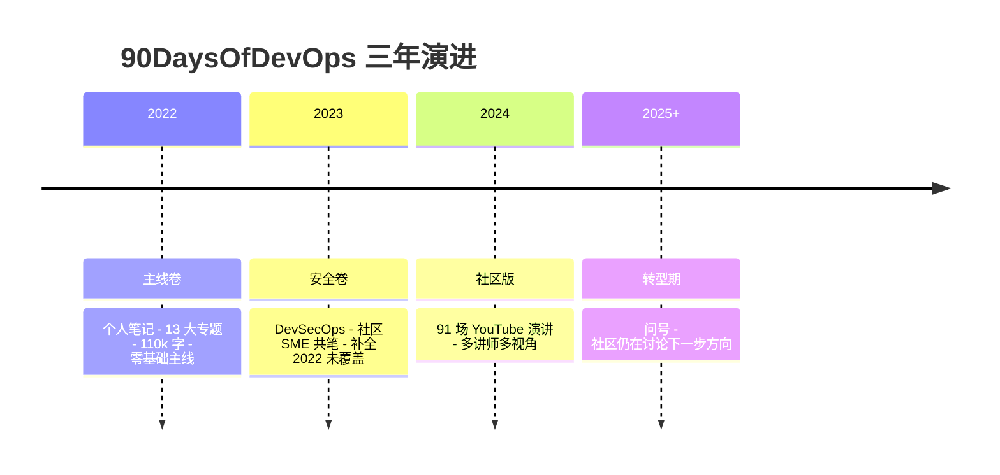

# MichaelCade/90DaysOfDevOps

[GitHub URL](https://github.com/MichaelCade/90DaysOfDevOps)

## 90DaysOfDevOps 深度评测：90 天打牢 DevOps 地基的开源学习地图

> 一份近 3 万 Star、三年三卷的开源 DevOps 系统化学习路线，每天 1 小时，90 天从零构建完整知识体系。

- **Tags**: DevOps, 开源项目, 学习路线, DevSecOps, GitHub
- **Category**: 开发工具, 技术教程, 开源项目

## Details

# MichaelCade/90DaysOfDevOps 深度评测：一份用 90 天把 DevOps"地基"打牢的开源学习地图
> **一句话总结**：这是一位英国老运维在 2022 年元旦开启的"公开学习实验"，如今已经长成近 3 万 Star、三年三卷、被社区翻译成多国语言的 DevOps 学习地图——它最大的价值不是教你装工具，而是**用 13 个专题替你把 DevOps 这门"隐学"的目录表写明白了**。
---
## 一、背景与痛点：DevOps 的"目录之谜"
很多想转 DevOps 的工程师都有同一个困惑：Google 一下能搜出上百份"DevOps 工具清单"，每篇文章推的工具都不一样，读完以后脑子里只有一堆"工具名"——Jenkins、Terraform、Ansible、ArgoCD……却依然不知道**这些工具为什么存在、解决了流程里的哪一步、彼此之间是什么关系**。
这就是 DevOps 学习的真实痛点：**知识高度碎片化，缺乏一条贯穿"原理—流程—工具—场景"的主线**。市面上要么是单一厂商的付费课程（带私货），要么是 84k Star 但更像"题库"的 `bregman-arie/devops-exercises`，要么是 roadmap.sh 那种一屏塞满节点的可视化脑图——看上去很全，但每条线只有一句话简介，点进去又是外链。
**90DaysOfDevOps 选择了第三条路：一个人写完整的一本"公开笔记"，然后让社区接力修订和扩展。**
作者 **Michael Cade** 的履历是理解这个项目定位的关键：他目前是 **Veeam 的 Field CTO / Director of Product Strategy**，此前在 Kasten by Veeam（Kubernetes 备份领域的头部产品）担任 Global Technologist，IT 行业 20+ 年，在 Veeam 待了 10 年以上。换句话说，他不是 YouTube 上那种"三个月速成 DevOps"的教程博主，而是一位**一线讲了十几年云原生数据保护、又常年跑客户现场的 Field CTO**——这决定了他写东西的视角：偏企业实战、偏体系而非偏炫技。
项目的起点是 2022 年 1 月 1 日到 3 月 31 日的 90 天，每天 1 小时，最终沉淀出**约 11 万字的成体系笔记**。三年下来它已经长成：**29.9k Star、6.8k Fork、2015 次提交、多语言翻译、配套 YouTube 91 场社区演讲、独立网站 90daysofdevops.com**。
---
## 二、三年三卷：项目结构全景
仓库主目录很干净——就是三个年份文件夹 + 三张路线图 Markdown：
| 卷 | 主题 | 体量 | 适合阶段 |
|---|---|---|---|
| **2022**（主线卷） | DevOps 13 大专题，110k 词 | 90 天 / 90 篇 Markdown | 零基础入门 |
| **2023**（DevSecOps 卷） | 安全 + 上一版没讲完的话题，社区 SME 共笔 | 90 天 / 14 个专题 | 进阶补全 |
| **2024**（社区版） | 91 场 YouTube 演讲，由社区讲师贡献 | 91 天 / 视频 | 专题深耕 |
它的三年演进大致如下：

### 2.1 2022 主线卷：13 大专题把 DevOps 拆给你看
这是项目最初的灵魂，也是大多数人应该从这一卷开始的原因。它把 DevOps 拆成 13 块基础拼图，每周围绕一个专题：
| 天数 | 专题 | 核心技术 |
|---|---|---|
| Day 1–6 | DevOps 基础 | 概念、生命周期、DevOps vs 敏捷 |
| Day 7–13 | 一门编程语言 | **Go**（变量、指针、调用 Twitter API） |
| Day 14–20 | Linux 基础 | 命令行、文件系统、vim、SSH、bash |
| Day 21–27 | 计算机网络 | OSI 七层、协议、Python 网络自动化 |
| Day 28–34 | 云服务商 | **Azure**（计算/存储/网络/安全模型） |
| Day 35–41 | Git | 暂存、变基、开源工作流 |
| Day 42–48 | 容器 | Docker、镜像、Compose、网络 |
| Day 49–55 | Kubernetes | 集群部署、Rancher、Ingress、State |
| Day 56–62 | IaC | **Terraform**、HCL、模块、多环境 |
| Day 63–69 | 配置管理 | **Ansible**、Playbook、Vault、AWX |
| Day 70–76 | CI/CD | Jenkins、GitHub Actions、ArgoCD |
| Day 77–83 | 监控与日志 | ELK、EFK、Fluentd、Grafana |
| Day 84–90 | 存储与数据保护 | 备份恢复、灾难恢复、可移植性 |
注意一个有意思的细节：**第 84–90 天的"存储与数据保护"在几乎所有其他 DevOps 学习路线里都是缺席的**——而这一块恰恰是 Michael Cade 老本行（Kasten K10 就是干 Kubernetes 备份的）。这其实是这份路线图最"独家"的部分，也是**生产环境真正出过事故的工程师最关心的部分**。
### 2.2 2023 DevSecOps 卷：把安全从"事后检查"塞进"流程左移"
2023 卷的最大变化是**不再单兵作战，而是引入社区 SME 共笔**——每个专题换一位该领域的一线专家执笔，作者只做引言和收尾。这 90 天覆盖：
- **DevSecOps 思维**（红队 vs 蓝队、像攻击者一样思考）
- **安全编码**（SAST + SonarCloud、SCA + OWASP Dependency Check）
- **持续集成中的安全**（镜像扫描、模糊测试、DAST/IAST）
- **交付阶段的安全**（镜像签名、制品扫描、漏洞扫描）
- **运行时防护**（审计、行为检测、网络策略）
- **密钥管理**（HashiCorp Vault 实操 + Kubernetes Secrets）
- **Python / AWS / OpenShift / 数据库 / Serverless / Service Mesh / Day 2 运维**
如果你只能选一卷读，且已经有一定基础，我会推荐这一卷——它的实操密度明显高于 2022 卷，且每章都是不同行业老兵的视角。
### 2.3 2024 社区版：从"一个人写"到"一群人讲"
2024 年作者干脆把笔放下了，改用 Sessionize 招募社区讲师，**跑了 91 场 YouTube 视频**（2024 是闰年，有 91 天）。仓库里每天对应的不再是 Markdown 文章，而是视频简介 + 摘要。比如 Day 01 是作者本人做的开篇演讲，回顾前两年+预告社区版。
---
## 三、核心亮点：它凭什么拿近 3 万 Star
### 3.1 体系化，而不是工具化
这是它区别于"Awesome 列表"和"脑图路线"最核心的差异。每篇文章都试图回答三个问题：**为什么需要这个东西 → 它解决流程里的哪一步 → 怎么动手跑一遍**。比如讲 Terraform 时不是堆一堆 HCL 命令，而是先讲为什么手工管基础设施会失控，再讲 Provider / State / Module 的概念，最后才给 HCL 示例。
### 3.2 多语言翻译 + 社区纠错闭环
仓库原生支持**英文 / 简体中文 / 繁体中文 / 西班牙语 / 韩语 / 越南语 / 波兰语**等多语言版本，全部直接在仓库的 `2022/zh_cn`、`2022/zh_tw` 等子目录中维护。这一点非常难得——它不是把 PDF 丢出去让读者自己机翻，而是把翻译当成**仓库的一等公民**维护，社区译者会持续修正错译。
### 3.3 商业立场干净，没有带货嫌疑
README 明确声明：**项目不接受厂商赞助，所有内容基于免费、社区和开源软件**。这一点对于一份 DevOps 学习资料来说价值极高——你看不到"为什么你应该买某某云"、"为什么某某 SaaS 更好"这种软广。
### 3.4 许可证明确：CC BY-NC-SA 4.0
内容采用 **CC BY-NC-SA 4.0**——可以自由分享与改编，但**禁止商用**，衍生作品需沿用同一协议。这意味着：你可以拿它做团队内训资料（非商业），可以 fork 后改写为公司内部文档，但**不能拿去做付费培训或打包进商业产品**——想这样用的人要看清边界。
### 3.5 配套设施完整
- **独立网站 90daysofdevops.com**，基于 docsify 构建（仓库里的 `index.html` + `_sidebar.md` + `.nojekyll` 是典型 docsify 标志），浏览器打开即读，无需 clone；
- **YouTube 播放列表**收录 91 场社区演讲；
- **Discord 社区**用于提问与互动；
- **GitHub Actions** 自动检查 Markdown 格式。
---
## 四、横向对比：它在 DevOps 学习资源里处于什么位置
| 资源 | Star | 形态 | 学习方式 | 适合谁 |
|---|---|---|---|---|
| **MichaelCade/90DaysOfDevOps** | 29.9k | 90 天 Markdown 课程 | 每日 1h，按日推进 | 想要**体系化主线**的入门者 |
| **bregman-arie/devops-exercises** | 84.4k | 2600+ 道问答 | 自测、面试刷题 | 已有基础，准备面试 |
| **roadmap.sh/devops** | — | 可视化脑图 | 节点式外链跳转 | 想快速**概览全貌**的人 |
| **milanm/DevOps-Roadmap** | — | 单页路线图 | 资源聚合 | 选型参考 |
| **TrainWithShubham/90DaysOfDevOps** | 1.3k | Shell 脚本作业 | 任务驱动提交 | 想靠 commit 攒作品集 |
| **bregman-arie/devops-resources** | — | 资源聚合 | 外链列表 | 工具箱查询 |
一句话定位：**90DaysOfDevOps 是"教材"，devops-exercises 是"题库"，roadmap.sh 是"地图"**。三者不是竞争关系，而是从"学—练—查"三个环节互补使用。
和同样叫 `90DaysOfDevOps` 的 TrainWithShubham 版本对比尤其有意思——后者是完全独立的项目，主打"每天一个 shell 任务 + Git commit 作品集"，更接近 bootcamp 作业；而 MichaelCade 这版是**以"知识理解"为主、动手为辅**，没有强制你 fork 后每天提交，自由度更高但自律要求也更高。
---
## 五、目标人群与收益
| 人群 | 推荐读法 | 核心收益 |
|---|---|---|
| **想转 DevOps 的后端/运维** | 2022 卷按日推进 90 天 | 拿到一份**完整知识地图**，不再被工具名淹没 |
| **1–3 年 DevOps 工程师** | 直接读 2023 DevSecOps 卷 | 补齐安全短板，理解 DevSecOps 全链路 |
| **技术负责人 / 团队 Lead** | 把 2022 卷做团队内训大纲 | 现成的、可商用的（NC 范围内）学习路线 |
| **做云原生备份 / SRE 的同行** | 直读 2022 卷 Day 84–90 | 几乎是**全网唯一**把数据保护放进 DevOps 主线的资料 |
| **准备面试的工程师** | 2022 卷 + devops-exercises 配合 | 教材打底 + 题库自测 |
---
## 六、上手方式：90 天怎么用最划算
它是文档项目，没有安装配置，但有几种典型使用方式：
### 方式 A：经典 90 天刷法（推荐新手）
1. 打开 `2022.md`，看到 13 个专题的进度 checkbox；
2. 每天读 1 篇对应的 `Days/dayXX.md`，遇到实操就跟着链接的教程跑；
3. 在自己的 fork 里勾掉 checkbox，用 GitHub commit 记录进度；
4. 卡住时去 YouTube 看对应的 2024 社区版视频补充视角。
### 方式 B：模块化跳读（推荐有基础的人）
直接按自己薄弱的专题选读：缺 Kubernetes 就读 Day 49–55，缺 IaC 就读 Day 56–62，缺 CI/CD 就读 Day 70–76。每篇独立成文，跳读完全 OK。
### 方式 C：中文优先刷法（中文用户）
直接进 `2022/zh_cn/` 目录，从 `README.md` 开始按日推进。注意：中文版中带 🔍 标记的条目表示"正在翻译"，部分文章可能仍是英文原版或机翻质量。
### 方式 D：DevSecOps 进阶刷法
2022 卷读完后，直接进 `2023.md`，按 14 个专题推进，每个专题换一位社区专家，体验不同视角。
---
## 七、局限与不足：避坑指南
评测不能只说好话，这份路线图有几个**真实存在的坑**：
### 7.1 2022 卷部分内容已显过时
最典型的是 Day 48 标题就是 "**Docker 替代 Kubernetes**"——Docker Swarm 在 2024 年后的云原生生态里已经边缘化，这一篇作为"容器编排的另一种思路"还有点价值，但**不能作为生产选型参考**。另外 Day 28–34 的云服务商选的是 **Azure**，而中文社区主流是 AWS / 阿里云，如果你不用 Azure，这一周的"实操"部分只能当思路读，不能照抄命令。
### 7.2 动手实操依赖外部资源
仓库本身**不提供开箱即用的 Lab 环境**——没有 Dockerfile、没有 Vagrantfile、没有 Terraform 脚本目录，每天的文章里大量外链到 Medium、官方文档和外部教程。这意味着：**链接腐烂风险较高**，部分 2022 年的外链已经 404。和 TrainWithShubham 那种"fork 后跑脚本交作业"的体验相比，这里是"自己搭环境跟着读"。
### 7.3 2024 卷的可检索性差
社区版的 91 场演讲以视频为主，仓库里只有文字摘要，**没有按"工具 / 主题 / 难度"的索引**。想找"某场讲 Istio Ambient Mesh 的视频"得自己翻 `2024/` 目录。
### 7.4 中文版质量参差不齐
`zh_cn` 翻译由社区维护，**早期章节质量高，后期章节有较多未翻译或机器翻译痕迹**。建议中文读者遇到关键概念时**对照英文原文**确认。
### 7.5 2025 年后的方向不确定
README 中 2025 年那一栏目前仍是问号（"Where should we take this next? Are we finished?"）。项目近 1 年主要在维护翻译和 Issue，**没有再新增主线卷**。对于想学最新技术（AI for DevOps、Platform Engineering、Backstage、OpenTelemetry 时代的新观测体系）的读者，这里不是最佳来源。
### 7.6 不是面试刷题库
和 `devops-exercises` 那种 2600 道问答不同，这里是**叙述性文章**，没有"题目—答案"结构。读完它面试还是要去刷题。
---
## 八、结语：给三类读者的一句话行动建议
> **如果你是零基础想入行 DevOps 的小白**：现在就 fork 这个仓库，从 `2022/zh_cn/README.md` 的 Day 1 开始，**用 90 天把它啃完**——这是你能找到的最完整、最中立、且免费的中文友好路线图。配合 `devops-exercises` 题库自测、roadmap.sh 看全貌、TrainWithShubham 仓库找动手任务，**一条主线 + 三件辅助**就能把 DevOps 地基打牢。
> **如果你是有 1–3 年经验的工程师**：跳过 2022 卷基础部分，**直接读 2023 DevSecOps 卷 + 2022 卷的 Day 84–90（数据保护）**。这两块是你大概率没系统学过、又是生产事故高发区的盲区，Michael Cade 和他请来的那批 SME 在这两块的视角有真正的"Field CTO 含金量"。
> **如果你是技术负责人**：把它作为团队内训大纲 fork 进公司内部仓库（注意 NC 协议禁止商业售卖），按 13 个专题安排每周读书会，比自研大纲省 1 个月时间。
最后一句真心话：在 GitHub 上找 DevOps 学习资料，Star 数大不代表质量高——84k Star 的 `devops-exercises` 是好题库但不是教材，roadmap.sh 是好地图但每条线只有一句话。**29.9k Star 的 90DaysOfDevOps 之所以独特，是因为它坚持用"一个人 + 一个体系 + 一份长期主义"的笨办法，把 DevOps 这门学科的第一本"公开教材"写完了**。在 AI 一键生成"DevOps 学习路线"的 2026 年，这份笨拙而完整的中文友好版资料，反而显得愈发珍贵。
**仓库地址**：https://github.com/MichaelCade/90DaysOfDevOps ｜ **配套站点**：https://www.90daysofdevops.com
