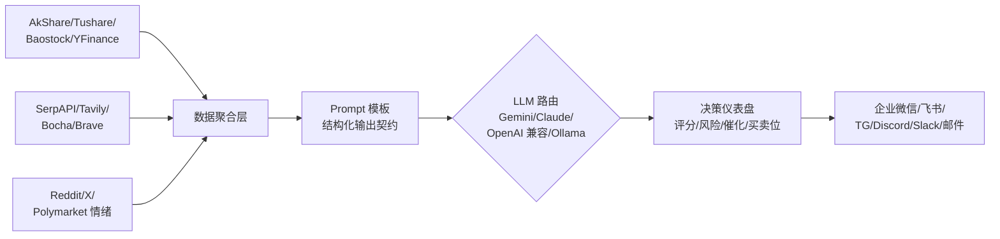

# ZhuLinsen/daily_stock_analysis

[GitHub URL](https://github.com/ZhuLinsen/daily_stock_analysis)


## daily_stock_analysis 深度评测：用 LLM 打造每日自动盯盘的股票分析推送工具

> 用 LLM 把自选股行情与新闻舆情自动生成结构化决策报告，Fork 即部署、零服务器成本定时推送到手机。

- **Tags**: LLM, 股票分析, 自动推送, GitHub Actions, 开源项目
- **Category**: AI 应用, 金融投资, 开发工具

## Details

# 《用 LLM 给自己编了个"分析师"：daily_stock_analysis 深度评测》
> 它不是选股器，不是量化框架，而是把"自选股行情 + 新闻舆情 → LLM → 结构化决策仪表盘 → 推送到你手机"这条流水线做成了一个 **Fork 即部署、GitHub Actions 零成本跑批** 的开源工程模板——对**想自动盯盘的个人投资者**和**想学 LLM 工程化落地的开发者**，都是一份难得可抄的"实战参考答案"。
---
## 一句话总结
**daily_stock_analysis** 是 ZhuLinsen 维护的 MIT 协议开源 Python 项目，用 LLM 把你自选的 A股/港股/美股/日股/韩股/台股每日做一次"决策仪表盘"分析，并自动推送到企业微信、飞书、Telegram、Discord、Slack 或邮箱；2026 年 1 月 10 日开仓以来，已冲到 **67,913 Star / 56,060 Fork**，Fork/Star 比高达 **82%**，远超一般开源项目的传播形态。
**一句话价值主张**：把"每天自己盯盘、查新闻、做笔记"压缩成"每天 18:00 看一条推送"，并且**零服务器成本**。
---
## 项目档案速览
| 维度 | 数据（2026-11-08 实测） |
|---|---|
| Star / Fork | 67,913 / 56,060 |
| 主语言 | Python 3.10+（前端 React） |
| 开源协议 | MIT |
| 创建时间 | 2026-01-10 |
| 累计提交 | 704 commits / 265 branches / 129 tags |
| 部署形态 | GitHub Actions / Docker / 本地 cron / FastAPI / Web 工作台 |
| 覆盖市场 | A股、港股、美股、日股、韩股、台股、ETF |
| 推送渠道 | 企业微信、飞书、Telegram、Discord、Slack、钉钉、邮件、Pushover |
| 配套项目 | AlphaSift（选股）、AlphaEvo（策略进化）、展示站 dsa.zhulinsen.tech |
数据来源：README 与仓库快照。
---
## 一、背景与痛点：它到底解决了什么
### 1.1 散户的"信息过载"困境
一个典型的个人投资者日常是这样：早上打开券商 App 看自选股、中午刷雪球和财联社、晚上复盘当日 K 线和资金流、再配合看各种研报——**信息分散、时间碎片化、结论碎片化**。等到第二天开盘，前一天的思考已经被新消息冲散了。
daily_stock_analysis 的核心循环只有一句话：
> **行情 + 新闻 + 舆情 → LLM 分析 → 结构化报告 → 多渠道推送**
它不打算替代券商 App、不打算替代 Wind、也不打算替代专业量化平台，它只做一件事：**把"每日复盘"这件事自动化成一条可扫读的推送**。
### 1.2 为什么它能瞬间爆红
CSDN 那篇分析给出一个关键洞察：**它把 GitHub 的"Fork 按钮"变成了"部署按钮"**。
传统的开源金融项目要本地装 Python、配数据库、跑 Docker、买服务器；而这个项目让你：
1. 点 Fork
2. 配三个 Secrets（`STOCK_LIST`、AI Key、通知 Webhook）
3. 启用 Actions
5 分钟后，每天下午 6 点，推送就来了。**部署门槛的坍塌，让 Fork 数变成了 Star 数的 82%**——很多人 Fork 完就真的在跑，这是大多数开源项目做不到的。
> 当部署成本被压到"点一下 Fork"，开源项目的传播模型就变了。
### 1.3 它和"AI 炒股"的本质区别
值得注意的是，**它明确不是自动交易系统**。README 把自己定位在"信息聚合 + LLM 结构化报告"层面，并明示"不构成投资建议"。这与最近 Nof1 在 Alpha Arena 实验中让 8 个大模型真金白银炒股、4 场竞赛 **81% 失败率** 形成了鲜明的反差——AI 用来看盘做笔记是神器，用来下单实盘是赌博。
---
## 二、核心亮点：四件事拼成一条流水线

### 亮点一：真正的"多市场"覆盖
绝大多数同类开源项目要么只做 A 股，要么只做美股。daily_stock_analysis 的 `STOCK_LIST` 用一行字符串就支持六市场混写：
```
600519,hk00700,AAPL,7203.T,005930.KS,2330.TW
```
市场路由由代码后缀自动完成，用户不需要为每个市场单独配管道。对持有茅台+腾讯+英伟达+丰田这种"全球配置"的个人投资者来说，这是"一个配置管全部"的体验。
### 亮点二：报告骨架是定死的（这是它敢推到企业群的底气）
很多人担心"让 LLM 写报告是不是每天长得不一样"。这个项目把**输出字段契约化**了：每只股票的推送都有相同的结构——
```
⚪ 中钨高新 (000657)
📰 重要信息速览
💭 舆情情绪: 市场关注其AI属性与业绩高增长，情绪偏积极...
📊 业绩预期: 公司2025年前三季度业绩同比大幅增长...
🚨 风险警报:
   风险点1：主力资金大幅净卖出3.63亿元...
   风险点2：筹码集中度高达35.15%...
✨ 利好催化:
   利好1：被市场定位为AI服务器HDI核心供应商...
   利好2：扣非净利润同比暴涨407.52%...
```
顶部还有一行全局摘要：`共分析 3 只股票 | 🟢买入:0 🟡观望:2 🔴卖出:1`。
**这就是"LLM 结构化报告"与"让 AI 自由写作"的分野**——字段化输出让报告可扫读、可对比、可被程序继续加工，也让"AI 预测 vs 次日实际"的 1 日回测成为可能。
### 亮点三：Web 工作台与 Agent 策略问股
它不只是个"定时推送脚本"，配套还有完整的 Web 工作台（FastAPI + React）：
- **手动分析**：临时跑某只股票
- **历史报告**：完整 Markdown 归档
- **回测页**：AI 预测 vs 次日实际涨跌的准确率
- **持仓管理**、**图片/CSV/Excel/剪贴板导入**（Vision LLM 识别截图里的代码）、**拼音/别名股票代码补全**
- **/chat 策略问股**：多轮追问，内置**均线金叉、缠论、波浪理论、趋势跟随、热点题材、事件驱动、成长质量、预期重估**等 15 种策略，Agent 实时调用行情、K 线、技术指标、新闻作为上下文
这等于把"看盘软件 + 问股助手 + 定时推送"捏成了一个开源工作台。
### 亮点四：完整的数据源与模型"插拔式"架构
它没有把自己绑死在单一生态，每层都给了 3-8 个备选：
| 层 | 免费默认 | 付费/进阶 |
|---|---|---|
| AI 模型 | Gemini API（Google AI Studio 免费额度） | Claude、OpenAI 兼容（DeepSeek/通义）、Modelflare、AIHubMix、Ollama 本地 |
| 行情 | AkShare、Baostock、YFinance | Tushare（A股）、Longbridge（港美股） |
| 新闻搜索 | —（强烈建议配） | SerpAPI、Tavily、Bocha、Brave、Anspire、SearXNG 自建 |
| 社交舆情 | —（可选） | Reddit/X/Polymarket 情绪 API（美股） |
这种**"零配置能跑、配 Key 更稳"**的分层设计，既让小白能 fork 起来用，也给了重度用户升级空间。
---
## 三、技术栈与架构剖析
### 3.1 目录结构（来自完整指南）
```
daily_stock_analysis/
├── main.py                # 主入口（CLI 串联）
├── src/                   # 核心业务
│   ├── analyzer.py        # LLM 分析器
│   ├── config.py          # 配置管理
│   └── notification.py    # 推送适配
├── data_provider/         # 多数据源 Adapter
├── bot/                   # Bot 交互（TG/Discord/飞书/企微）
├── api/                   # FastAPI 后端
├── apps/dsa-web/          # React 前端
├── strategies/            # 策略文件（可自定义）
├── docker/                # Docker 配置
└── .github/workflows/     # Actions 工作流
```
架构上有几点值得称道：
1. **数据源 Adapter 模式**：`data_provider/` 把 AkShare/Tushare/Pytdx/Baostock/YFinance/Longbridge 全部包成统一接口，上层调用方不感知下游差异，更换数据源只改 Adapter。
2. **fail-open 降级**：fundamental_context（估值/成长/盈利/机构/资金流/龙虎榜/板块）各维度独立取数，主链路 fail-open，某一路挂了不会让整个分析失败。
3. **Actions 工程细节**：工作日 18:00 触发、A/H/US 多市场节假日跳过、断点续传、强制运行开关——这套**"每交易日跑批"**的工程范式可以直接抄到任何同类项目。
### 3.2 最小可用代码示例
**本地跑一次（一行命令）：**
```bash
git clone https://github.com/ZhuLinsen/daily_stock_analysis.git && cd daily_stock_analysis
pip install -r requirements.txt
cp .env.example .env && vim .env
python main.py --dry-run   # 先只看，不推送
```
**`.env` 最小配置（三行就能跑起来）：**
```ini
STOCK_LIST=600519,hk00700,AAPL
GEMINI_API_KEY=your_key_here            # AI 模型
FEISHU_WEBHOOK_URL=https://open.feishu.cn/open-apis/bot/v2/hook/xxx   # 推送渠道
# 可选：SERPAPI_API_KEYS / TUSHARE_TOKEN
```
**GitHub Actions 关键 YAML 片段：**
```yaml
on:
  schedule:
    - cron: '0 10 * * 1-5'    # UTC 10:00 = 北京 18:00，周一到周五
  workflow_dispatch:            # 手动触发
jobs:
  analyze:
    runs-on: ubuntu-latest
    steps:
      - uses: actions/checkout@v4
      - uses: actions/setup-python@v5
        with: { python-version: '3.10' }
      - run: pip install -r requirements.txt
      - run: python main.py
        env:
          STOCK_LIST: ${{ secrets.STOCK_LIST }}
          GEMINI_API_KEY: ${{ secrets.GEMINI_API_KEY }}
          FEISHU_WEBHOOK_URL: ${{ secrets.FEISHU_WEBHOOK_URL }}
```
**常用 CLI 开关**（来自 README）：
```bash
python main.py --debug                  # 调试日志
python main.py --dry-run                # 只分析不推送
python main.py --stocks 600519,AAPL     # 临时覆盖自选股
python main.py --market-review          # 大盘复盘（指数涨跌、板块、北向资金）
python main.py --schedule               # 本地定时
python main.py --serve-only             # 仅起 FastAPI 服务
python main.py --webui                  # 启动 Web 工作台（默认 8000 端口）
```
### 3.3 部署体验评分
| 维度 | 评分 | 说明 |
|---|---|---|
| 文档完整度 | ⭐⭐⭐⭐⭐ | README + full-guide 三语种，配置项、字段契约、市场边界全覆盖 |
| Fork 部署难度 | ⭐⭐⭐⭐⭐ | 5 分钟，3 个 Secrets 就能跑 |
| 本地部署难度 | ⭐⭐⭐⭐ | 一行 pip install，但需自己管 cron |
| Docker | ⭐⭐⭐⭐ | 官方 docker/ 目录 |
| 报错友好度 | ⭐⭐⭐⭐ | 免费源未配置时打"警告"但不阻断运行 |
| 中文资料 | ⭐⭐⭐⭐⭐ | 中文原生项目 |
---
## 四、目标人群与收益
| 人群 | 主要收益 | 推荐强度 |
|---|---|---|
| **个人散户**（A股/港美股混搭） | 每天 18:00 自动拿到决策仪表盘，省去手动盯盘与读新闻时间 | ⭐⭐⭐⭐⭐ |
| **Python 工程师 / AI 应用开发者** | 学一套**完整的"LLM 结构化输出 + 定时批处理 + 多渠道推送"参考实现**，可直接迁移到非金融场景 | ⭐⭐⭐⭐⭐ |
| **量化入门者** | 学数据 Adapter 模式、fail-open 设计、回测页实现思路 | ⭐⭐⭐⭐ |
| **团队/小机构** | 把自选股周报、行业动态做成自动化 LLM 简报推飞书群 | ⭐⭐⭐ |
| **严肃私募/专业投资者** | 不适合作为决策工具，但可作为舆情聚合的内部工具基座 | ⭐⭐ |
| **想"让 AI 帮我炒股赚钱"的小白** | **会失望**——它不会让你发财，它只是把你每天手工做的事自动化了 | ⭐ |
---
## 五、竞品对比：它到底在什么位置
| 项目 | 类型 | 多市场 | 自动推送 | Agent 问股 | 上手难度 | 适合人群 |
|---|---|---|---|---|---|---|
| **daily_stock_analysis** | LLM 结构化推送流水线 | ✅ A/H/US/JP/KR/TW | ✅ 8 渠道 | ✅ 15 策略 | ⭐ 极低 | 个人投资者 + 工程师 |
| **TradingAgents-astock**（xmshaka fork） | 多 Agent 投研辩论框架 | A 股特化（龙虎榜/游资/解禁） | ❌ | 辩论式 | ⭐⭐⭐ | 研究型开发者 |
| **TradingAgents-CN** | 多智能体 LLM 交易框架 | 美股为主 | ❌ | 多 Agent 辩论 | ⭐⭐⭐ | 量化研究者 |
| **OpenBB** | 金融数据平台 + AI Agent | 全球 | ❌ | 部分 | ⭐⭐⭐⭐ | 专业分析师 |
| **TrendRadar**（同作者家族） | 舆情监控 MCP 工具 | 不限 | ✅ | ✅ | ⭐⭐ | 内容/舆情监控 |
| **熔岩 / Aiguagua 等 SaaS** | 商业 AI 投研平台 | A 股为主 | ✅ | ✅ | ⭐ | 付费个人用户 |
数据来源：TradingAgents-astock README、腾讯云开发者社区 AI 工具全景、sofarbot 项目档案。
**daily_stock_analysis 的独特生态位**：它是这些项目里唯一一个**把"Fork 即部署 + 多市场 + 定时推送"三件事同时做到极致**的，TradingAgents 类项目能力更强但部署门槛高（要 Python/Docker、无现成推送、单次决策 API 成本 $0.5-2）；OpenBB 专业但更偏数据平台而非自动分析流水线。
---
## 六、风险、局限与避坑指南
这是评测里最重要的部分，**这个项目有一些坑必须提前知道**。
### ⚠️ 风险一：LLM 幻觉
它推送出来的"买卖点位"、"风险警报"、"利好催化"，**字面看上去非常像分析师报告，但本质是 LLM 基于搜到的新闻做的自然语言总结**。可能出现的坑：
- 编造不存在的"机构目标价"
- 把旧闻当成"最新动态"
- 评分带有 LLM 自身的偏见（例如对"AI 概念股"系统性偏乐观）
- 多轮运行同一只股票，结论可能不一致（LLM 非确定性）
**避坑**：用回测页看历史"AI 预测 vs 次日实际"准确率，对单只股票跑 1-2 周再做判断；对推送里的数字（特别是资金流、估值）**自己去券商 App 复核一遍**再用。
### ⚠️ 风险二：免费数据源的"薛定谔可用"
AkShare、YFinance 这些免费源的现状是：
- 上游网站改版，接口就悄悄失效，没人通知你
- 批量拉数据 ~200 次就触发 IP 限流
- 文档参数名与实际行为不一致
- 日线数据收盘后 30-60 分钟才稳定
**避坑**：fork 后先跑 `--dry-run` 看日志里哪些数据源拉到了、哪些是空的；如果做长期定时，**强烈建议配 `TUSHARE_TOKEN`（A股）和 `LONGBRIDGE`（港美股）**；自选股建议**控制在 5-10 只以内**，超过这个量免费源会频繁超时。
### ⚠️ 风险三：新闻质量直接决定报告质量
不配新闻源的话，LLM 只能基于行情和自己的"记忆"做分析——**这就是个定时炸弹**（容易幻觉）。README 明确"新闻源显著影响舆情、公告、事件和催化因素质量"，建议至少配一个（SerpAPI 或 Bocha 都行）。
**避坑**：SerpAPI 免费额度只有 100 次/月，自选股 5 只每天跑一次也够；Bocha 中文优化较好，A 股党可以选它。
### ⚠️ 风险四：GitHub Actions 的隐性限制
- 个人免费账号每月 **2000 分钟 Actions 配额**
- 每次 run 默认 30-60 分钟（取决于自选股数和 LLM 响应速度）
- 公共仓库的 fork 仓库 Actions 默认关闭，要手动 enable
**避坑**：自选股 ≤10 只，每天跑一次，月耗约 1500-2000 分钟，**刚好在配额边缘**。如果跑得多，要么降到每工作日 1 次，要么本地跑 cron。
### ⚠️ 风险五：合规与监管
- LLM 输出构成"投资建议"的边界在国内监管上比较敏感，**不要在企业群或公众号里直接转发它推送给他人**，尤其是带具体买卖点位的内容
- 如果你把它二次开发后商业化，要重新评估法律风险
- 它的数据源（AkShare 等）本身来自爬虫/反编译上游接口，**商业用途需谨慎**
### ⚠️ 风险六：项目本身的"生命周期风险"
短期内 Star 67K、单作者+社区贡献者、连续 5 个月高频迭代，**活跃度没问题**。但要注意：
- 这是个单核心维护者项目，一旦作者弃坑，需要社区接盘
- 上游依赖（AkShare/Tushare/LLM API）变动会导致频繁失效，需要持续维护
- 没有机构背书，没有 audited backtest 数据
---
## 七、行动建议：分人群落地路线
### 如果你是个股散户（最常见）
1. **Step 1**：Fork 仓库，配 `STOCK_LIST` + `GEMINI_API_KEY`（Google AI Studio 免费）+ 飞书 Webhook，三件套就够
2. **Step 2**：手动 Run 一次 workflow，看推送效果——**此时不要相信任何买卖点位**
3. **Step 3**：跑 1 周，去 Web 工作台回测页看"AI 预测 vs 次日实际"准确率
4. **Step 4**：自选股控制 ≤8 只，配一个新闻源（推荐 Bocha），让报告质量上一个台阶
5. **Step 5**：把它当作"每日信息聚合器"而不是"决策依据"，**点开推送后自己去券商 App 复核**
### 如果你是开发者（最值得研究它的人）
1. **Step 1**：读 `src/analyzer.py`，看它是怎么用 Prompt 模板把 LLM 输出"框"进结构化字段的
2. **Step 2**：读 `.github/workflows/`，学"工作日 18:00 触发 + 多市场节假日跳过 + 断点续传"这套 Actions 工程范式
3. **Step 3**：读 `data_provider/`，学多源 Adapter + fail-open 降级设计
4. **Step 4**：把它当**"LLM 结构化报告"的参考实现**——同样的套路可以套到竞品监控、舆情日报、SEO 内容自动化、产品周报生成等所有"每日 LLM 推送"场景
### 如果你想认真做投资决策（请绕行）
这个项目**不是**给你用的。它的决策来源是公开新闻 + LLM 总结，没有任何 alpha 因子、没有机构级数据、没有合规审计。你的选择应该是：
- 数据终端型：Wind AI / iFinD / 问财（A 股党）
- 专业研究型：AlphaSense / Kensho（贵但可溯源）
- 多智能体框架：TradingAgents-astock 做研究型选股
- 量化平台：聚宽 / BigQuant 自己写因子
---
## 八、结语与终极评判
> **它的最大价值，不是让你赚钱，而是让你把"每天复盘 30 分钟"这件事省下来，并且给所有做"LLM 工程化落地"的开发者提供了一份完整的、可以照抄的代码模板。**
具体打分（满分 10）：
- **部署体验**：9.5 / 10（Fork 即部署，5 分钟出推送）
- **架构与代码质量**：8.5 / 10（模块化清晰，fail-open 严谨，LLM 输出契约化）
- **文档**：9 / 10（三语种 + full guide + 示例丰富）
- **社区活跃度**：9 / 10（704 commits、月度高频迭代、活跃 Issue/PR）
- **作为投资工具的价值**：4 / 10（LLM 幻觉、无 alpha、不可复现）
- **作为学习模板的价值**：9.5 / 10（"LLM + 定时批处理 + 多渠道推送"标杆样本）
- **综合**：**8.5 / 10**
**一句忠告**：把它当工具，不当水晶球。每日 18:00 那条推送是**信息聚合**，不是**投资指令**——点开看完，记得自己去券商 App 把每个数字都核实一遍。至于"Fork 它就能稳赚"这种说法，Nof1 已经用 81% 的失败率替我们试过了。
钱包的事，还是自己负责。
