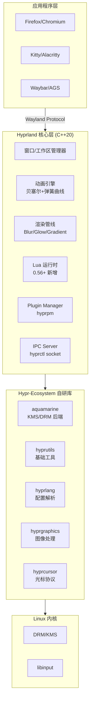

# hyprwm/Hyprland

[GitHub URL](https://github.com/hyprwm/Hyprland)


## Hyprland 深度评测：把 Linux 桌面雕琢成作品的 Wayland 合成器

> 一款自带动画、模糊、发光特效的动态平铺 Wayland 合成器，让 Linux 桌面既高效又养眼。

- **Tags**: Wayland, Linux桌面, 窗口管理器, 平铺WM, 开源
- **Category**: 开发工具, 操作系统桌面, 开源项目

## Details

# Hyprland 深度评测：把 Linux 桌面当成一件作品来雕琢的 Wayland 合成器
> Hyprland 是一款 100% 自研的动态平铺 Wayland 合成器，用动画、模糊、发光把"性冷淡"的平铺窗口管理器第一次做出了"杂志级"质感，是 2022–2026 年间 Linux 桌面圈最快崛起的现象级项目——但它的"颜值税"、NVIDIA 兼容性与社区争议，也需要被摆上台面讲清楚。
---
## 一、背景与痛点：为什么 2022 年的 Linux 桌面需要一个新的合成器？
在 Hyprland 出现之前，Linux 平铺窗口管理器（WM）世界有一条公认的"铁律"：**想要键盘驱动的高效工作流，就要接受像素级的性冷淡界面**。i3、Sway、dwm 这一系的工具没有阴影、没有圆角、没有动画，窗口切换像在终端里翻书一样干脆，但视觉上属于"能用但不美"的水平。
而另一端，GNOME / KDE 这类完整的桌面环境虽然养眼，但启动慢、内存占用高、键盘工作流不够极致，对 r/unixporn 社区那批"想要每个像素都按自己意志渲染"的用户来说，过于臃肿。
Hyprland 的作者 **Vaxry（vaxerski）** 在 2022 年从 wlroots 上的一个小实验（hypr）开始，逐步走向了"自己造一套完整的合成器"的路线。它的核心定位非常锋利：**"a dynamic tiling Wayland compositor that doesn't sacrifice on its looks"——一个不在颜值上做妥协的平铺 Wayland 合成器**。
用一句通俗的话概括：**i3/Sway 是毛坯房里高效办公，GNOME 是精装房里温吞生活，Hyprland 是让你自己当设计师的精装毛坯房。** 截至 2026 年，它的 GitHub 主仓库已经拥有 **38.8k Stars、2.1k Forks、7,903 次提交**，是 Linux 桌面赛道近年增长最快的项目之一。
---
## 二、技术栈与架构：从"基于 wlroots"到"干掉 wlroots"
### 2.1 演进脉络
Hyprland 最初构建在 **wlroots**（Sway 作者 Drew DeVault 主导的 Wayland 后端库）之上，但作者很快做出一个激进的决策：**抛弃 wlroots，自己写一套渲染后端**。这就是 **Aquamarine** 的由来——一个只做底层 KMS/DRM/EGL 渲染的轻量库，专门为 Hyprland 服务。
这个决定既有技术理由（wlroots 抽象层对 Hyprland 复杂的动画/特效不够灵活），也有社区政治原因（Vaxry 与 FDO/wlroots 圈子的关系恶化，下文详述）。
### 2.2 整体架构（示意图）

值得强调的几点：
- **BSD-3-Clause 许可证**，可以商用、可以二次分发，没有 GPL 的传染性问题。
- **代码组织清晰**：仓库根目录下 `src/`（合成器主体）、`hyprctl/`（命令行控制工具）、`hyprpm/`（插件管理器）、`subprojects/`（生态子模块）、`protocols/`（Wayland 协议 XML）一一对应，对新贡献者相对友好。
- **0.56 / 0.57 引入 Lua 运行时**：官方已经宣布 **从 0.57 起旧版 `.conf` 配置不再支持**，全面转向 Lua。这是 Hyprland 近年来最具野心也最具争议的一次重构。
### 2.3 性能 trade-off：特效不是免费的
Hyprland 的模糊、阴影、动画都依赖 GPU 合成，性能上比 Sway 略重。官方 FAQ 直接给出了明确指引："如果想跑最大性能，关掉 blur 和 animations"——这是配置层面最常见的一条优化路径。
---
## 三、核心亮点与功能剖析
### 3.1 视觉特效：让 r/unixporn 重度用户上头的"魔法粉"
Hyprland 在 0.57 中已经支持：
- **多种 Blur 变体**（静态/动态/比例模糊），插件可以再扩展
- **Glow 渐变发光**、**渐变边框**、**阴影**
- **自定义贝塞尔 + 弹簧曲线动画**，窗口切换、移动、缩放都可以独立调参
- **Window Wobble**（致敬 Compiz 的"果冻窗口"）
- **Workspace Sharing**——浏览器/会议软件里可以直接选择"共享某个工作区"而不是整个屏幕，对做演示、远程协作的人来说是真正解决痛点的功能。
> **通俗比喻**：如果 Sway 是一把瑞士军刀，那 Hyprland 就是把瑞士军刀镶进了钛合金手柄，每一片刀刃打开都带阻尼回弹的慢动作。
### 3.2 平铺 + 浮动混合 + 特殊工作区
Hyprland 默认支持四种布局：**Dwindle**（螺旋二分）、**Master**（主从）、**Scrolling**（0.56 新增）、**Monocle**（单窗口全屏），并支持 **Per-Workspace Layout**（不同工作区用不同布局）和 **Custom Layout via Lua/Plugin**。
此外还有：
- **特殊工作区**：类似 i3 的 scratchpad，按热键把某个窗口"召唤出来/收回去"
- **窗口分组**：原生支持标签页模式
- **强大的 window rule**：可以用正则匹配窗口类名，配置成浮动、强制大小、禁止模糊、不显示在屏幕共享里等
### 3.3 IPC 与 hyprctl：把整个合成器当 API 调
Hyprland 的 **IPC 体系** 是它最容易被低估的能力。任何一个窗口、工作区、配置项，都可以通过 `hyprctl` 命令行或 Unix socket 查询/修改。这意味着：
- 你可以在 shell 脚本、waybar 模块、AGS（Astal+GTK）、Quickshell 这些状态栏里**实时读取当前工作区、活跃窗口、音量、亮度**并渲染成 UI
- 也可以通过 `hyprctl dispatch` **远程控制窗口行为**（比如让一个快捷键触发"把当前窗口扔到工作区 9"）
下面是一段**最小可用的 Hyprland 配置片段**（0.57 之前的 .conf 语法，目前社区 dotfiles 仍以这种形式为主），开发者一眼就能看出"怎么写、怎么用"：
```ini
# ~/.config/hypr/hyprland.conf （0.56 及之前版本）
# 监视器：分辨率、刷新率、缩放
monitor=eDP-1,2560x1600@165,0x0,1.25
# 输入
input {
    kb_layout = us
    follow_mouse = 1
    touchpad { natural_scroll = true }
}
# 动画：速度、曲线、开关哪些特效
animations {
    enabled = true
    bezier = myBezier, 0.05, 0.9, 0.1, 1.05
    animation = windows, 1, 7, myBezier
    animation = windowsOut, 1, 7, default, popin 80%
    animation = fade, 1, 7, default
}
decoration {
    rounding = 12
    blur { enabled = true; size = 6; passes = 3 }
    drop_shadow = true
}
# 窗口规则：把特定窗口强制设为浮动
windowrule = float, ^(pavucontrol)$
windowrule = pin, ^(rofi)$
# 自定义启动项
exec-once = waybar
exec-once = /usr/lib/polkit-gnome/polkit-gnome-authentication-agent-1
exec-once = swww-daemon && swww img ~/wall.jpg
# 键位：$mainMod 一般是 Super
$mainMod = SUPER
bind = $mainMod, Return, exec, kitty
bind = $mainMod, Q, killactive
bind = $mainMod, V, togglefloating
bind = $mainMod, 1~9, workspace, 1~9
bind = $mainMod SHIFT, 1~9, movetoworkspace, 1~9
```
这份配置保存即生效，**不需要重启合成器**——这也是 Hyprland 在 ricing 社区特别受欢迎的原因：调一版动画曲线只要 Ctrl+S 看一眼。
---
## 四、上手门槛与部署体验
### 4.1 安装难度（按发行版）
| 发行版 | 难度 | 命令/方式 |
|---|---|---|
| **Arch / EndeavourOS** | ⭐ | `pacman -S hyprland`，最丝滑 |
| **NixOS** | ⭐⭐ | `programs.hyprland.enable = true;` 一行开启 |
| **Fedora** | ⭐⭐ | 官方仓库有，但版本略滞后 |
| **openSUSE** | ⭐⭐⭐ | 曾多次出现 aquamarine 包版本脱节导致的崩溃 |
| **Debian / Ubuntu** | ⭐⭐⭐⭐ | 需要自行编译或使用第三方仓库，不推荐新手 |
**一个真实的坑**：Hyprland 自身已经完成从 `.conf` 到 **Lua 配置** 的迁移（0.57 起旧配置不再支持），**如果你直接 copy 三年前的 dotfiles，启动会一片黑屏或直接报错**。务必选择近 3 个月内有更新的 dotfiles 仓库。
### 4.2 必备的"生态拼图"
Hyprland 本身只是合成器，一个能日常使用的桌面还需要：
- **状态栏**：Waybar（最主流）/ AGS / Quickshell
- **启动器**：Rofi / Wofi / fuzzel
- **壁纸**：swww / hyprpaper
- **锁屏**：hyprlock（官方出品）
- **通知**：dunst / mako / SwayNC
- **截屏**：grim + slurp
- **屏幕共享**：xdg-desktop-portal-hyprland（官方出品，0.57 配套更新）
- **认证代理**：polkit-gnome 或 hyprpolkitagent
**没有这层拼图，你只是开进了一个有毛坯墙的房间。**
### 4.3 推荐的"懒人起步"路径：直接套用社区 dotfiles
对绝大多数用户来说，从零写一份完整的 Hyprland 配置是巨大的劝退点。社区有三个长期活跃、值得关注的 dotfiles 仓库：
1. **end-4/dots-hyprland**：以 Quickshell（QML）+ Illogical-impulse 主题闻名，是目前"颜值天花板"级别的 rice，适合想要"开箱即用又惊艳"的用户。
2. **prasanthrangan/hyprdots**（HyDE）：模块化安装脚本，支持自定义应用列表，适合想在 Arch 上快速搭一套完整桌面的人。
3. **ML4W dotfiles**：覆盖 Arch/Fedora/openSUSE 多发行版，配套一个设置 GUI，对新手最友好。
> **建议路径**：先用 end-4 或 ML4W 跑起来 → 用一段时间 → 再逐个文件读懂它的配置 → 把不喜欢的部分改掉。这比从空白配置硬啃要快得多。
---
## 五、社区活跃度与生命力
### 5.1 更新节奏：令人咋舌的"快"
- **0.55**（2026-05）、**0.56**（2026-07）、**0.57**（2026-10/11）——几乎每 2~3 个月一个里程碑版本。
- 主仓库 **7,903 commits**、**146 个 open PR**，主分支几乎每天都有提交。
### 5.2 生态矩阵：hypr-* 全家桶
Hyprland 不只是单个仓库，它已经形成了 **Hypr-Ecosystem**：
- **aquamarine**：底层 KMS/DRM 后端
- **hyprutils / hyprlang / hyprgraphics / hyprcursor**：基础库
- **xdg-desktop-portal-hyprland**：屏幕共享协议实现
- **hyprpm**：插件管理器，支持 `hyprpm update` 一键更新
- **hyprlock / hypridle / hyprpaper / hyprpicker**：官方周边
### 5.3 社区争议（必须客观指出）
任何 Hyprland 的深度评测都绕不开这部分，否则就是不负责任的评测。
**核心争议：创始人 Vaxry 与 freedesktop.org 的冲突。**
- **Drew DeVault（Sway/wlroots 作者、FDO 成员）** 在 2023 年公开撰文，指责 Hyprland 社区存在严重的歧视言论与"toxic"氛围，并表示"不推荐任何不打算远离其社区空间的人使用 Hyprland"。
- **Vaxry 本人被 freedesktop.org 禁止提交代码与报 bug**，禁令由 Red Hat 员工依据 Hyprland Discord 上的言论做出，引发了大量"开源政治化"的争论，最终导致 Hyprland 全面脱离 wlroots 生态。
- **技术上的连带影响**：Wayland 协议演进、NVIDIA 驱动配合等本可以与 FDO 协作的领域，Hyprland 现在需要单打独斗。
**客观的结论**：技术值得，社区氛围你自有判断。可以把 Hyprland 当工具用、把 GitHub Issue 当沟通渠道，但 Discord/Matrix 社区的氛围确实和 GNOME、Sway 这种"工程师味"浓厚的社区不同。
---
## 六、竞品对比：Hyprland 在 Wayland/平铺 WM 生态中的位置
| 维度 | **Hyprland** | **Sway** | **KDE Plasma (Wayland)** | **GNOME (Wayland)** | **Niri** |
|---|---|---|---|---|---|
| **架构基础** | 100% 自研（Aquamarine） | wlroots | KWin | Mutter | 独立（Rust） |
| **颜值/特效** | ⭐⭐⭐⭐⭐ | ⭐ | ⭐⭐⭐⭐ | ⭐⭐⭐⭐ | ⭐⭐⭐ |
| **稳定性** | ⭐⭐⭐（崩溃偶发） | ⭐⭐⭐⭐⭐ | ⭐⭐⭐⭐ | ⭐⭐⭐⭐ | ⭐⭐⭐ |
| **可定制性** | ⭐⭐⭐⭐⭐（Lua+Plugin） | ⭐⭐⭐ | ⭐⭐⭐⭐ | ⭐⭐（受限于 GNOME 设计哲学） | ⭐⭐⭐ |
| **学习成本** | 中高 | 中 | 低 | 低 | 中 |
| **NVIDIA 支持** | ⭐⭐（仍需 env 变量+修补） | ⭐⭐ | ⭐⭐⭐⭐ | ⭐⭐⭐⭐ | ⭐⭐⭐ |
| **社区氛围** | 极活跃但有争议 | 工程师风、克制 | 大而稳定 | 大而稳定 | 小而新 |
| **目标用户** | Rice 玩家 / 追求极致体验的开发者 | 服务器向、稳定性党 | 通用桌面用户 | 通用桌面用户 | Scrollable 派 |
**几个值得单独说明的点：**
- **Hyprland vs Sway**：功能上 Sway 更稳定、更"工程"；Hyprland 更花哨、更激进。从 Sway 迁移的用户常提到需要 **hy3 插件** 才能补齐 Sway 风格的 tabbed 布局。
- **Niri** 是 2024 年后冒头的"Scrollable Layout"新秀，定位与 Hyprland 不完全重叠，但吃掉了一部分想要"更稳更简单"的用户。
- **i3** 仍是 X11 阵营的常青树，但在 2026 年，新装的桌面基本没有理由再选 X11。
---
## 七、目标人群与收益
### 7.1 谁应该用？
| 人群 | 收益 |
|---|---|
| **开发者 / 运维 / SRE** | 键盘驱动的工作区切换 + 多显示器布局保存，效率提升明显；纯文本配置可以丢进 dotfiles 仓库版本管理 |
| **Linux 桌面 Rice 爱好者** | 直接收获动画/模糊/发光/渐变边框的全套"魔法粉"，是 r/unixporn 高产素材库 |
| **追求性能的笔记本用户** | 在高性能模式下，动画流畅度接近 macOS，但内存占用比 GNOME 低 30%~50% |
| **内容创作者 / 演示者** | Workspace-level 屏幕共享，会议时只共享代码编辑器，不暴露私人窗口 |
| **Linux 极客 / 学习者** | 源码结构清晰，是学习 Wayland 协议、KMS/DRM、C++20 现代特性的优质样本 |
### 7.2 谁不应该用？
- **生产环境依赖 NVIDIA 专有驱动的笔记本用户**：尽管 Hyprland 已经支持 NVIDIA，但需要手动设置环境变量（如 `__GLX_VENDOR_LIBRARY_NAME`、`AQ_NO_MODIFIERS=1`），且 BUG 反馈量大，遇到问题需要自己啃 GitHub Issue。
- **希望"装完即用"的纯小白**：再漂亮的 dotfiles 也需要你理解 dconf、systemd user service、portal 这些概念。
- **企业 IT 部署**：上游更新激进、 occasionally 会出现重大 breaking change（如 .conf → Lua 迁移），不符合"稳定压倒一切"的场景。
---
## 八、局限与不足（毫不避讳版）
1. **偶发的崩溃**：动画系统、aquamarine 多 GPU 检测、DRM 事件处理等模块都出现过 crash issue，与 Sway "装完忘掉" 的体验有差距。
2. **`.conf → Lua` 迁移造成生态断档**：0.57 起旧配置不再支持，**网上 90% 的教程和 dotfiles 正在迅速过时**，新手如果照搬旧资料会一头雾水。
3. **NVIDIA 体验仍不算丝滑**：Aquamarine 在 NVIDIA 专有驱动上仍需要环境变量修补，wayland 通用协议支持比 KWin/GNOME 慢一拍。
4. **社区政治包袱**：FDO 禁令事件不仅让 Hyprland 失去了与上游协作的便利，也在某些大型发行版（如 Debian）的邮件列表里引发了"是否打包 Hyprland"的争论，间接影响了主流仓库的收录节奏。
5. **特效默认即负载**：blur + animations + glow 在 Intel 核显的老笔记本上掉帧明显，**必须自己手动关闭**才能保证流畅。
6. **文档分散**：官方 wiki（hypr.land）质量不错，但 Lua API 文档仍在完善中，很多新特性要靠看 release note 和 GitHub commit 才能搞清楚。
---
## 九、结语与行动建议
**Hyprland 是 Linux 桌面历史上一道独特的风景**：它用一个人的偏执 + 一个活跃社区的力量，证明了"平铺窗口管理器"这个曾经被视为极客玩具的赛道，也可以做得既高效又养眼。它的 38.8k Stars 不是营销堆出来的，而是来自无数 r/unixporn 玩家和开发者真心实意的转发。
**如果你打算入手，推荐的路径是：**
1. **优先在 Arch / EndeavourOS / NixOS 上尝试**——这三者是生态最完整、问题反馈最少的发行版。
2. **直接套用 end-4/dots-hyprland 或 ML4W dotfiles** 作为起点，跑通后再逐文件读懂配置。
3. **留意 0.57+ 的 Lua 迁移**：搜教程时加上 `2026` 或 `Lua` 关键词，避免踩旧资料的坑。
4. **NVIDIA 用户**：先在虚拟机或备用机试，确认兼容再上主力机。
5. **想要稳就 Sway、想要美就 Hyprland、想要"装完就忘"就 KDE**——没有最优解，只有最适合你的解。
一句话收尾：**Hyprland 不是最稳的 Wayland 合成器，但它把"Linux 桌面可以美得像作品"这件事，变成了大众触手可及的现实。** 这一点，已经足够它载入 Linux 桌面史册。
