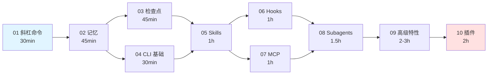

# luongnv89/claude-howto

[GitHub URL](https://github.com/luongnv89/claude-howto)


## claude-howto：GitHub 上最系统的 Claude Code 学习指南（41k+ Stars）

> GitHub 上最系统化、最具可执行性的 Claude Code 教程仓库，10 个模块 + 120 余份即用模板，带你从新手进阶到 Agent 编排高手。

- **Tags**: Claude Code, GitHub 开源, AI 编程, 教程, 模板库
- **Category**: AI 编程, 开发工具, 教程学习

## Details

# claude-howto 深度评测：把 Claude Code 的"说明书"升级成"驾驶手册"
> **一句话定位**：这是 GitHub 上目前**最系统化、最具可执行性**的 Claude Code 学习指南——用 10 个循序渐进的模块、120+ 份可直接复制到项目里的模板，以及 Mermaid 可视化架构图，把你从"会敲 `claude` 命令"带到"能编排 Agent 团队"的高级玩家。截至目前已突破 **41k Stars**、全球仓库排名第 1499 位，是 Claude Code 生态中被引用频率最高的教程仓库之一。
---
## 一、它到底解决什么痛点？(The "Now What?" Problem)
作者 Luong Nguyen 在 README 里那段开场白非常戳人，几乎每个装了 Claude Code 的人都经历过这个瞬间：
> "You installed Claude Code. You ran a few prompts. **Now what?**"
这背后的核心问题不是"功能不够"，而是**官方文档天然是参考书（Reference），不是教程**。打个比方：
- **官方文档**像一本《汉语词典》——你能查到"钩子（Hooks）"这个词的定义，但不知道"用钩子拦截所有 `git push` 并自动跑安全扫描"这种组合拳该怎么打。
- **claude-howto** 像一本《如何用汉语写小说》——它假设你认识字，直接教你组合运用。
Claude Code 的能力分散在 **Slash Commands / Memory / Skills / Subagents / MCP / Hooks / Plugins / Checkpoints** 八个相互独立又可组合的机制里，新手最容易犯的错就是"什么都学了一点，什么都没串起来"。这个仓库的核心价值就是**把这些机制按学习曲线重新排序、并用真实项目场景串联**。
---
## 二、作者背景：一个做安全的工程师为什么要写这个？
| 维度 | 信息 |
|------|------|
| 姓名 | Luong Nguyen (luongnv89) |
| 现职 | 法国巴黎 Montimage 公司 Senior R&D Engineer |
| 领域 | AI + 网络安全（DPI 深度包检测、反钓鱼、实时安全告警） |
| 项目经验 | 主持/参与 COGNIMAN、CyberSuite、Puzzle、Geiger 等多个欧洲安全科研项目 |
| 其他代表作 | asm（通用 AI Skill 管理器）、context-stats（Claude Code 用量统计）、sleek-ui |
**为什么这个背景重要？** 因为这决定了仓库的"味道"——它不是营销号写的"10 个 Prompt 让你效率翻倍"那种水文，而是一个在生产环境里真刀真枪用 LLM 做安全分析和自动化的工程师，反过来沉淀给自己的工程方法论。所以你会看到它对 **Hooks 的 read-only 安全模式**、**Subagents 的工具权限隔离**、**MCP 的企业代理 allowlist**（比如明确提醒 `downloads.claude.ai` 要加入企业白名单）这些"运维向"细节着墨很多——这些恰好是纯粹的开发者教程最容易忽略的。
---
## 三、内容架构解析：10 模块 × 125 个特性 × 11-13 小时
仓库的主体结构极其工整，编号即学习顺序：
```
01-slash-commands/    入门必学：68+ 个命令（60+ 内置 + 8 个自定义示例）
02-memory/            持久化上下文：7 种记忆类型 + CLAUDE.md 模板
03-checkpoints/       会话快照与回滚
04-cli/               CLI 命令、参数与无头模式
05-skills/            可复用能力：15 个 Skill（9 个内置 + 6 个示例）
06-hooks/             事件驱动自动化：25-29 个事件钩子
07-mcp/               外部工具接入：9 个 MCP Server 配置
08-subagents/         专项 AI 助手：17 个子代理定义
09-advanced-features/ 规划模式、思考模式、后台任务
10-plugins/           打包分发：3 个完整插件包
```
其中内置的 **CATALOG.md** 是一张"特性全景表"，你可以把它当成 Claude Code 的"速查卡"——103 个内置特性 + 47 个可复制的示例，每个都标注了"调用方式 / 持久化层级 / 最佳使用场景 / 安装命令"四列。
### 学习路径（用一张 Mermaid 图看懂）

入门 2.5 小时，进阶 3.5 小时，全通 5 小时——这个时间预算设计相当克制，没有把自己包装成"30 天精通"那种虚胖课程。
---
## 四、核心亮点：为什么不是"又一个教程"？
### 亮点 1：模板都是"拿来即用"的生产级代码
来看一个真实文件 `01-slash-commands/optimize.md`（仅 22 行，但结构完整）：
```markdown
---
description: Analyze code for performance issues and suggest optimizations
---
# Code Optimization
Review the provided code for the following issues in order of priority:
1. **Performance bottlenecks** - identify O(n²) operations, inefficient loops
2. **Memory leaks** - find unreleased resources, circular references
3. **Algorithm improvements** - suggest better algorithms or data structures
4. **Caching opportunities** - identify repeated computations
5. **Concurrency issues** - find race conditions or threading problems
Format your response with:
- Issue severity (Critical/High/Medium/Low)
- Location in code
- Explanation
- Recommended fix with code example
```
复制到你的项目 `.claude/commands/` 目录下，重启 Claude Code，输入 `/optimize`，立刻可用。**没有广告、没有"加群领取完整版"**——这是它和大量引流式 Claude 教程最本质的区别。
再看 `02-memory/project-CLAUDE.md` 的模板：它用一个虚构的电商项目做示范，完整覆盖了架构引用（`@docs/architecture.md`）、代码风格、命名约定、Git 工作流、测试覆盖率阈值、API 规范、部署策略、已知问题与临时方案、相关项目索引等 10+ 个板块。把它抄过来，改几个字段就能变成你自己团队的 CLAUDE.md。
### 亮点 2：Mermaid 图解"底层为什么这样设计"
这是和官方文档拉开差距的最大杠杆。官方文档告诉你 **Hooks 有 25 个事件**，claude-howto 则画出了完整的**事件流时序图**，让你一眼看出：
- `PreToolUse` 能**拦截并修改工具输入**（可以做权限校验、注入额外上下文）
- `PostToolUse` 不能拦截但能**给 Claude 反馈**（可以做安全扫描、格式检查）
- `Stop` / `SubagentStop` 可以配合 `prompt` 类型的 Hook 做"任务完成度智能判断"
一张图胜过三段文档，对视觉型学习者非常友好。
### 亮点 3：跨语言支持（5 种语言）
README 顶部就有语言切换：English | Tiếng Việt | 中文 | Українська | 日本語。中文版的存在对国内读者是实打实的减负——你可以用中文读概念，用英文看代码示例（代码注释本身就是英文的，混着读反而更自然）。
### 亮点 4：内置自测机制（这是最像"课程"的地方）
仓库里埋了一个 **`/self-assessment`** 命令模板和 **`/lesson-quiz [topic]`** 模板。你把它们复制到自己的 `.claude/commands/` 之后，Claude Code 会根据你的回答**生成个人化的学习路径**——告诉你哪些模块可以跳过、哪些需要补课。这是把"线性教程"变成"自适应学习"的巧妙做法。
### 亮点 5：与 Claude Code 主版本保持同步
仓库明确标注"Actively maintained — synced with every Claude Code release (latest: **v2.1.296, October 2026**)"。这一点极其关键——Claude Code 迭代速度极快（v2.1.x 每周都有新命令、新事件、新语法），很多 2025 年初的热门 Claude Code 教程现在已经失真，而 claude-howto 的 CATALOG.md 甚至能跟踪到 `/usage` 在 v2.1.149 新增的分项计费、v2.1.174 VSCode 扩展的归因分析这种颗粒度的变化。
### 亮点 6：支持离线 EPUB
```bash
uv run scripts/build_epub.py
```
一键把全部教程和渲染好的 Mermaid 图打包成 EPUB 电子书——地铁通勤、飞机上都能看，这是纯 GitHub 教程少见的贴心设计。
---
## 五、上手体验：15 分钟到底能干什么？
官方承诺 "Get Started in 15 Minutes"，实际验证下来确实成立：
```bash
# 1. 克隆仓库
git clone https://github.com/luongnv89/claude-howto.git
cd claude-howto
# 2. 复制第一个自定义斜杠命令
mkdir -p /path/to/your-project/.claude/commands
cp 01-slash-commands/optimize.md /path/to/your-project/.claude/commands/
# 3. 在 Claude Code 中输入 /optimize，立即可用
# 4. 设置项目记忆
cp 02-memory/project-CLAUDE.md /path/to/your-project/CLAUDE.md
# 5. 安装一个 Skill
cp -r 03-skills/code-review-specialist ~/.claude/skills/
```
**门槛评估：** 
- 对 **有 Git 和命令行基础的开发者**：零门槛，纯复制粘贴。
- 对 **完全没装过 Claude Code 的新手**：需要先看完官方 `npm install -g @anthropic-ai/claude-code` 安装说明，然后回来就能跟上节奏。
- 对 **想定制企业级 Hook 的人**：需要理解 JSON Schema 和退出码语义，仓库的 06-hooks/README.md 讲得足够细，但需要 1-2 小时专注阅读。
---
## 六、横向对比：它在生态中处于什么位置？
2025 年底以来 Claude Code 生态爆发式增长，同类资源至少有十几个。下面这张表帮你判断 claude-howto 的相对位置：
| 资源 | Stars | 定位 | 适合谁 |
|------|-------|------|--------|
| **luongnv89/claude-howto** | ~41k | **结构化教程 + 模板库** | 想系统学完 Claude Code 全部能力的开发者 |
| hesreallyhim/awesome-claude-code | 55.9k | 手工精选的资源索引 | 已有基础、想找新工具/新 Skill 扩展的人 |
| ykdojo/claude-code-tips | - | 45+ 条 Tips 清单 | 已上手、想找速效技巧的人 |
| affaan-m/everything-claude-code | 141k | 激进聚合器（什么都收） | 想"淘金"的人，需要自己过滤噪声 |
| rohitg00/awesome-claude-code-toolkit | - | 135 个 Agent + 176 个 Plugin 的大礼包 | 想要开箱即用大礼包的人 |
| FlorianBruniaux/claude-code-ultimate-guide | - | 43 万行规模竞品，含视频课 | 喜欢视频+长文混合学习的人 |
| Anthropic 官方文档 | - | 特性参考 | 遇到具体 API 参数问题的所有人 |
| punkpeye/awesome-mcp-servers | - | MCP Server 专项索引 | 只关心 MCP 集成的人 |
**claude-howto 的独特竞争力**可以用一句话概括：**它是唯一一个把"教"放在第一位的**。awesome-* 系列是"索引"（告诉你有什么），官方文档是"参考"（告诉你怎么用单个特性），而 claude-howto 是"教练"（告诉你按什么顺序学、学到什么程度算掌握、如何组合拳打）。
---
## 七、局限与不足：别把它当圣经
作为一个负责任的评测，必须把短板说清楚。
### 局限 1：部分模板质量参差不齐
第三方 Skill 评测平台 Tessl 对仓库中最受推崇的 `code-review-specialist` 做了自动评分，**整体质量分只有 67%**：
- **引用了不存在的文件**：SKILL.md 里让 Claude 读取 `templates/review-checklist.md` 和 `templates/finding-template.md`，但这两个文件在仓库中**并不存在**。Agent 真的去读时会失败。
- **脚本缺少调用示例**：`scripts/analyze-metrics.py` 和 `scripts/compare-complexity.py` 存在，但模板里没有写出如何命令行调用它们。
- **尾部有大量时效性噪声**：版本号、Last Updated、Compatible Models 列表挤占上下文窗口，对 Agent 执行任务毫无帮助。
这说明**仓库的"广度"策略（125 个特性全铺开）牺牲了部分深度**——不是每个模板都经过同等严格的自检。
### 局限 2：有些示例过于偏 Node.js 生态
`project-CLAUDE.md` 模板默认 Jest + Cypress + Prettier + Airbnb ESLint，对 Python、Rust、Go、Java 技术栈的开发者需要自己大量改写。如果你是 Python 工程师，建议把 `02-memory/` 模板当"骨架参考"而不是直接照抄。
### 局限 3： contributors 只有 8 人，单点风险
虽然 Star 数量巨大，但核心贡献者仍然集中在作者一人。仓库的 issue/PR 数量也偏少（~15 开 issue、~19 PR），说明它更像一个"作者主导的项目"而不是"社区驱动的项目"。**如果作者某天弃更，这个仓库的时效性会迅速衰减**——而 Claude Code 的迭代速度决定了停更 3 个月的教程就会开始失真。
### 局限 4：缺少真实项目的"踩坑实录"
模板很漂亮，但**"我在生产环境用这套 Subagent 组合时遇到过这些坑"**这种实战复盘较少，作者把这部分内容拆到了自己的 Medium 博客（`medium.com/@luongnv89`）里，仓库本体偏"教科书"。想要实战叙事的人，需要额外去看 Blog Posts 链接。
### 局限 5：对"非英文母语+非编程背景"用户仍有门槛
尽管提供了 5 种语言，但代码示例、Hook JSON 结构、YAML frontmatter 本身是英文/技术语法的，对纯小白仍有相当门槛。**它不是"零基础编程"教程，而是"零基础 Claude Code"教程**。
---
## 八、目标人群画像：你应该花时间吗？
| 人群 | 推荐指数 | 建议切入方式 |
|------|----------|--------------|
| **刚装好 Claude Code 的开发者** | ⭐⭐⭐⭐⭐ | 直接走 01→02→05 路径，2.5 小时入门 |
| **用了一段时间但感觉没发挥出威力的中级用户** | ⭐⭐⭐⭐⭐ | 跳到 06-Hooks 和 08-Subagents，最容易突破瓶颈 |
| **想给团队搭 AI 编码工作流的 Tech Lead** | ⭐⭐⭐⭐ | 重点看 02-memory 和 10-plugins，再结合官方 CLAUDE.md 文档 |
| **纯小白（没写过代码）** | ⭐⭐ | 先学基础 CLI 和 Git，再回来 |
| **Vim/Emacs 极客、只想要 cheatsheet** | ⭐⭐⭐ | 直接下载 CATALOG.md 当速查卡用 |
| **想写自己的 Claude Code 教程的博主** | ⭐⭐⭐⭐⭐ | 作为结构蓝本和事实核对的权威参考 |
**具体能带来的收益**：
1. **时间收益**：不用自己再去啃几十份官方文档和分散的博客，把 30+ 小时的研究时间压缩到 11-13 小时。
2. **效率收益**：模板复制即用，例如 `/commit`、`/pr`、`/setup-ci-cd` 这类命令模板能让你第 1 天就省下重复输入的时间。
3. **认知收益**：Mermaid 架构图让你理解"为什么 Hooks 能做 MCP 做不了的事"、"为什么 Skill 要比 Subagent 轻量"这类结构性问题，避免"用错工具"。
4. **团队收益**：CLAUDE.md 模板 + Checkpoints + Memory 组合，可以快速搭建团队共享的 AI 编码规范。
---
## 九、行动建议：一个 7 天学习计划
如果你决定入坑，这是我基于仓库结构推荐的最佳路径：
**Day 1（30 分钟）**：克隆仓库，复制 `/optimize` 和 `/commit` 到你的项目，先用起来。
**Day 2-3（2 小时）**：通读 02-memory，把 `project-CLAUDE.md` 模板按自己的项目改写成真实版。这一步的价值最大——90% 的人 Claude Code 用不好，根因就是 CLAUDE.md 太薄。
**Day 4（1 小时）**：学 06-hooks，至少配置一个 `PostToolUse` 钩子（比如每次 Write 后自动跑 lint）。
**Day 5（1.5 小时）**：学 08-subagents，定义一个属于你团队的 "code-reviewer" 子代理，配只读权限。
**Day 6（1 小时）**：学 07-mcp，接入至少一个实用 MCP Server（如 filesystem 或 git）。
**Day 7（2 小时）**：浏览 09-advanced-features 和 10-plugins，关注 Planning Mode 和后台任务，这两个是释放 Claude Code "Agent 团队"威力的钥匙。
**重要提醒**：在 `/self-assessment` 里先做一次自测，根据结果**跳过你已经熟悉的部分**——这是仓库设计者本人推荐的方式，也是对抗"教程疲劳"的最有效手段。
---
## 十、终极评判
**claude-howto 是 2026 年 Claude Code 生态中最值得收藏的"教科书型"仓库**——它不完美（部分模板质量参差、有死链、社区贡献者偏少），但它是目前**唯一**把"教初学者"作为第一优先级、同时保持与官方版本严格同步、并附带生产级模板的指南。
给三种人的最终评级：
- **如果你是刚入门或中级开发者**：⭐⭐⭐⭐⭐ **必收**。即使只用其中 20% 的内容，也足够你从"会聊天"进化到"会编排 Agent"。
- **如果你是资深 Claude Code 用户**：⭐⭐⭐⭐ **值得当参考书**。把它当 CATALOG.md 速查卡使用，而不是从头读教程。
- **如果你是团队 Leader 想推 AI 工作流**：⭐⭐⭐⭐ **作为团队 onboarding 教材**，但要补上自己团队的 Python/Go/Java 模板。
最后一句忠告：**教程只是起点，真正让 Claude Code 变成"外挂"的，是你把它套到自己的具体工作流里反复调教。** claude-howto 给了你引擎和轮胎，路还是要自己跑。
