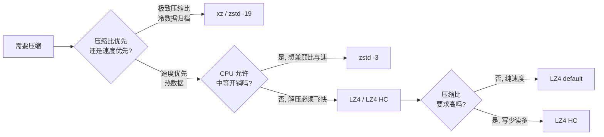

# lz4/lz4

[GitHub URL](https://github.com/lz4/lz4)


## LZ4 深度评测：把压缩速度逼近内存带宽的性能怪兽

> LZ4 是一个极致追求压缩与解压速度的开源无损压缩库，解压速度接近 5GB/s，是操作系统、数据库、游戏引擎背后的隐形基石。

- **Tags**: 压缩算法, 高性能, C语言, 开源项目, BSD协议
- **Category**: 开发工具, 性能优化, 开源库

## Details

# LZ4 深度评测：那个把压缩速度逼近内存带宽的"性能怪兽"
## 一句话总结
LZ4 是一个由 Yann Collet 主导、以 BSD-2-Clause 协议开源的无损压缩算法库，**它存在的唯一使命就是把压缩/解压速度推到物理极限**——压缩 780 MB/s、解压近 5 GB/s，几乎贴上内存带宽的天花板，因此成为实时计算、游戏引擎、操作系统内核、分布式存储里"看不见但离不开"的底层基石。
---
## 背景与痛点：为什么需要一个"快到离谱"的压缩算法
在 LZ4 出现之前（2011 年），工程师面对一个尴尬的取舍：
- 想要高压缩比 → 用 gzip/zlib/xz，但压缩速度只有几十 MB/s，放在热路径上会把 CPU 烧穿；
- 想要快 → 只能用 LZO、Snappy 这类"快但不强"的算法，压缩比也一般；
- 更要命的是，**解压速度**经常比压缩速度还慢——这在"写一次、读无数次"的读密集场景里是灾难。
Yann Collet 当时关注的是实时场景：日志流、数据库索引、游戏资源加载、内核 I/O——这些地方，**压缩必须是"几乎免费"的**，否则宁可存原始数据。LZ4 就是为这个痛点而生的：它在算法层面砍掉一切花哨的熵编码，把"匹配-复制"做到极致，使得解压甚至能达到**多个 GB/s**，在多核系统上能跑满 RAM 带宽。
后来 Yann Collet 加入了 Facebook，又在 LZ4 的基础上做出了 ZSTD——后者通过加入 Huffman + FSE 熵编码换来了更好的压缩比，但**永远保留了 LZ4 那种"算法极简、CPU 友好"的设计哲学**。可以说，理解 LZ4，就理解了现代高速压缩的底层范式。
---
## 核心亮点与技术剖析
### 1. 算法原理：一个"疯狂翻字典"的故事
LZ4 的本质是 **LZ77 算法的极简实现**。用一个通俗比喻：
> 想象你在抄一份很长的文档，发现"阿里巴巴与四十大盗"这句话已经在前文出现过。普通压缩算法会拿出一本厚重的字典，给这句话编个复杂的码；而 LZ4 只做一件事——回头看一眼，喊一句："这里和前面第 1024 个字节开始的 12 个字符一模一样！"直接抄个指针就完事。
为了实现"回头看一眼"这个动作足够快，LZ4 做了几件精妙的设计：
- **哈希表做"最近出现位置"索引**：维护一张仅 16 KB 的哈希表（编译期可通过 `LZ4_MEMORY_USAGE` 调整），把每个 4 字节序列哈希后映射到它在输入流中最近出现的位置。查找是 O(1)，没有红黑树、没有二叉搜索，就是一次数组访问。
- **滑动窗口极小**：默认匹配距离上限是 64 KB，不需要维护庞大的历史缓冲区，缓存命中率极高。
- **跳过启发式**：当算法发现当前数据"看起来压不动"（随机性太强），它会主动加大步长跳过一段，避免浪费 CPU。
- **无熵编码**：这是 LZ4 与 gzip/zstd 最大的差异。zstd 会再做一遍 Huffman/FSE 进一步压缩符号，而 LZ4 直接把"长度+距离"以字节流写出去——少了这一步，速度起飞，但压缩比封顶。
一句话概括：**LZ4 是把 LZ77 的"匹配-复制"环节优化到极致，并主动放弃熵编码的"偏科生"**——它数学上注定压不过 zstd，但在速度上无人能敌。
### 2. 双模式设计：Fast 与 HC 的取舍
| 模式 | 设计目标 | 适用场景 |
|---|---|---|
| **LZ4 (Fast)** | 极致速度，压缩比让路 | 热路径、实时流、数据库在线写入 |
| **LZ4_HC** | 用 CPU 时间换更高压缩比 | 离线归档、一次性写入后大量读取 |
关键的精妙之处在于：**两种模式产出的数据格式完全兼容，解压速度完全一致**。这意味着你可以"用 HC 慢慢压，用 Fast 火箭般解"，完美匹配"写少读多"的工作负载。
### 3. Frame 与 Block 双层格式：流式与互操作的关键
LZ4 定义了两层格式：
- **Block Format**：最原始的压缩块，只有"字面量 + 匹配"序列，不知道自己的总长度、没有校验和——适合嵌入式/自定义协议。
- **Frame Format**：在 Block 外套一层带魔数（Magic Number）、块大小、内容校验（XXHash）的"信封"，**这才是与其他系统/库交换数据时必须使用的格式**。
为什么这么设计？因为 Frame 里的魔数不同（zstd 和 lz4 的 magic number 不同），可以**在同一个流里混用 zstd 帧和 lz4 帧**，工具能自动识别——这是工程化的细心设计。
### 4. 字典模式：解决小数据压缩的杀手锏
LZ4 默认对小数据（如几百字节的网络包、单条日志）效果很差，因为匹配窗口都还没"预热"。LZ4 的解法是支持**任意输入文件作为字典**（最多使用末尾 64 KB），相当于提前给匹配窗口"预热"。配合 Zstandard 的 Dictionary Builder 训练专用字典，小文件压缩比可提升数倍。
---
## 实战演示：5 分钟上手
### CLI 使用（最简形式）
```bash
# 安装
git clone https://github.com/lz4/lz4 && cd lz4
make -j && sudo make install
# 压缩（默认级别 1，最快）
lz4 bigfile.log bigfile.lz4
# 用最高压缩比（HC -9）压一次，归档用
lz4 -9 bigfile.log bigfile.lz4
# 解压（速度都一样快）
lz4 -d bigfile.lz4 bigfile.restored
# 流式压缩（典型管道用法）
cat access.log | lz4 > access.log.lz4
zcat huge.log.gz | lz4 > huge.log.lz4   # 格式转换
# 字典模式压缩小文件
lz4 -D my.dict small_packet.bin small_packet.lz4
```
### C API 调用（开发者视角）
```c
#include <lz4.h>
#include <stdio.h>
#include <string.h>
int main() {
    const char *src = "Hello LZ4, Hello LZ4, Hello LZ4, ...";
    int src_size = strlen(src);
    // 1) 压缩：目标缓冲区必须预留足够空间
    int max_dst = LZ4_compressBound(src_size);   // 官方推荐的安全上限
    char *dst = malloc(max_dst);
    int compressed = LZ4_compress_default(src, dst, src_size, max_dst);
    printf("compressed %d -> %d bytes\n", src_size, compressed);
    // 2) 解压
    char *restored = malloc(src_size);
    int restored_size = LZ4_decompress_safe(dst, restored, compressed, src_size);
    printf("restored %d bytes: %s\n", restored_size, restored);
    free(dst); free(restored);
    return 0;
}
```
编译：`gcc demo.c -llz4 -o demo`。整个 API 只有几个核心函数，**没有上下文句柄、没有复杂状态机**，这就是"极简主义"的开发者体验。
---
## 应用场景全景图：它已经渗透到你每天用的每个系统
LZ4 的厉害之处不在于"你能用它做什么"，而在于**你其实每天都在用它而不自知**：
| 领域 | 代表系统 | 为什么选 LZ4 |
|---|---|---|
| **列式数据库** | ClickHouse（默认编码） | 热路径列扫描需要"边读边解"，解压必须跑得比磁盘还快 |
| **KV/嵌入式存储** | RocksDB、MyRocks（MySQL/MariaDB）、Apache Pegasus | LSM-Tree 的 compaction 频繁，压缩不能成为瓶颈 |
| **消息队列** | Apache Kafka（四大内置算法之一：gzip/snappy/lz4/zstd） | Broker 端 CPU 紧张，需要"低延迟解压" |
| **分布式存储** | Ceph（读密集场景推荐）、ZFS on Linux | 解压快 → 读放大低 → IOPS 高 |
| **游戏引擎** | Unity AssetBundle | 节省 40-60% 空间，同时支持**运行时按 chunk 解压**，无需整体载入内存 |
| **操作系统内核** | Linux Kernel（ZRAM、ZFS、BTRFS）、Zephyr RTOS | 内核态必须无锁、无堆分配、零拷贝 |
| **GPU 加速** | NVIDIA nvCOMP | 作为 GPU 上的快速压缩原语，加速 DataLoader |
| **搜索引擎** | Lucene / Elasticsearch | 倒排索引的 stored fields 压缩 |
一个值得注意的细节：ClickHouse 的工程师直接指出 **"LZ4 是热路径列的默认选择，ZSTD 是冷归档列的默认选择"** ——这是业界对 LZ4 定位最精准的一句话。
---
## 竞品对比：谁该在什么场景用什么
以下是 lzbench 在 Silesia Corpus 上的官方基准数据（i7-9700K，单线程）：
| 算法 | 压缩比 | 压缩速度 | 解压速度 |
|---|---|---|---|
| memcpy（基线） | 1.000 | 13700 MB/s | 13700 MB/s |
| **LZ4 default** | 2.101 | **780 MB/s** | **4970 MB/s** |
| LZO 2.09 | 2.108 | 670 MB/s | 860 MB/s |
| QuickLZ 1.5.0 | 2.238 | 575 MB/s | 780 MB/s |
| Snappy 1.1.4 | 2.091 | 565 MB/s | 1950 MB/s |
| ZSTD -1 | 2.883 | 515 MB/s | 1380 MB/s |
| **LZ4 HC -9** | 2.721 | 41 MB/s | **4900 MB/s** |
| zlib deflate -1 | 2.730 | 100 MB/s | 415 MB/s |
| zlib deflate -6 | 3.099 | 36 MB/s | 445 MB/s |
几张关键观察：
- **LZ4 的解压速度是 zlib 的 10 倍以上，是 zstd 的 3 倍以上**，几乎贴上 memcpy 的极限——这是它最不可替代的优势。
- **LZ4 HC 的压缩比与 zlib -1 接近**，但解压速度快 10 倍以上。
- **ZSTD -1 用比 LZ4 略慢的压缩速度换来了显著更好的压缩比**——所以在"压缩比和速度都想要"的场景，zstd 通常是折中的更优解。
- **Snappy 的解压只有 LZ4 的 40%**，但它有 Google 的"政治正确"，被 Kafka/BigTable 默认采用。从纯指标看，LZ4 几乎全面碾压 Snappy。
### 选型决策流程图

**记忆口诀**：**冷数据用 xz/zstd 高级别，热数据用 zstd -1~-3，实时/内核/数据库热路径用 LZ4。**
---
## 局限与不足：客观看它的边界
评测一个"明星项目"，更要冷静看它不能做什么。
### 1. 压缩比是硬伤，随机数据几乎无效
LZ4 完全放弃熵编码，这意味着：
- 对**已高度压缩的数据**（jpg、mp4、zip）几乎压不动，甚至可能轻微膨胀；
- 对**文本/JSON/日志**这类重复度高的数据，压缩比通常在 2~3x，远低于 zstd 的 3~4x、xz 的 4~5x。
如果你的瓶颈是**存储成本**而不是**IOPS/CPU**，LZ4 不是答案。
### 2. CLI 工具是单线程的
社区多次反馈 `lz4` 命令行工具不支持多线程并行压缩，对超大文件（如 100GB 的日志）的离线压缩速度会被单核限制。zstd CLI 早就支持 `--threads=N`，这是 LZ4 CLI 一个长期被诟病的点。当然，库本身完全可以在应用层自己做并行切片。
### 3. 小数据需要字典才能发挥
小于 1KB 的数据（网络包、单条消息）默认压缩效果很差，必须配合字典模式。这不是 bug 而是算法本质——匹配窗口需要"预热"。
### 4. Unity 等场景下的副作用
Unity 使用 LZ4 压缩 AssetBundle 时，会出现**小改动导致大更新的问题**：因为 LZ4 的压缩块是大块的，一个字节变化可能影响整个块的输出，导致 Steam 增量下载爆炸。这是块式压缩的固有特性，需要开发者在打包粒度上做权衡。
### 5. 周边生态的版本陷阱
- **lz4-java 已停止维护**，因 CVE-2025-12183，Maven Central 已把 `org.lz4:lz4-java:1.8.1` 重定向到社区 fork——Java 用户需注意迁移。
- 各语言 binding 的版本与 C 参考实现版本可能不一致，性能与 bug 修复进度参差。
### 6. 它不是"未来算法"
从更宏观视角，**zstd 在工程上"全面超越"LZ4 只是时间问题**：zstd -1 的速度已经逼近 LZ4 default，压缩比却高出一截。LZ4 的护城河越来越窄——只剩**极致的解压速度**和**内核/嵌入式场景下的极简实现**。短期不会消失，但增量场景正在被 zstd 蚕食。
---
## 社区活跃度与生命力
- **作者背景硬核**：Yann Collet 是 Facebook 前 Core Data 团队工程师，同时是 xxHash 和 ZSTD 的作者，是业界公认的"压缩界大神"。
- **协议 BSD-2-Clause**：**无任何传染性**，闭源商用零障碍，这是它能在内核、商业数据库、游戏引擎里被大规模采用的关键原因。
- **版本演进健康**：v1.9.4 包含约 350 次提交的修复，v1.10.0 已发布。社区 Issue 响应积极，性能回归问题会被认真讨论。
- **生态丰富**：官方维护一份多语言 binding 列表，涵盖 Java、C#、Python、Go、Rust、Perl、Ruby 等几乎所有主流语言。
- **学术与工业双重认可**：FPGA 硬件加速论文选择 LZ4 作为加速对象，NVIDIA nvCOMP、TI 嵌入式 SDK、Zephyr RTOS 等都直接集成它。
---
## 结语与行动建议
**LZ4 是那种"你不会去炫耀它、但它每天默默为你节省数十万 CPU 小时"的隐形冠军。** 它不是压缩比的王者，也不是算法理论的明珠，但它在"实时、热路径、解压密集"这个细分领域，至今没有真正的对手。
### 给不同读者的实操建议
- **后端工程师**：如果做 Kafka/ClickHouse/RocksDB 调优，**优先确认你的集群默认压缩是否是 LZ4**——热数据用它几乎永远比 Snappy/gzip 更优；冷数据可考虑切到 zstd。
- **游戏开发者**：Unity AssetBundle 选 LZ4 而非 LZMA（后者解压太慢会让加载卡顿），但要注意打包粒度以避免更新爆炸。
- **系统/嵌入式工程师**：ZFS/ZRAM/内核 I/O 路径，LZ4 是经过十年验证的"安全选择"。
- **业务开发者**：写日志压缩、网络传输、IPC 序列化，**直接用 zstd -1** 可能是更聪明的选择——比 LZ4 略慢但压得更小；只有当你**确定瓶颈在解压**时才上 LZ4。
- **学习者**：LZ4 的源码只有几千行 C，没有虚函数、没有复杂设计模式，是**读懂"工业级高性能 C 代码"的最佳入门样本**之一。读完它的 `lz4.c`，你对缓存友好性、分支预测、SIMD 优化会有体感层面的认知。
**一句话收尾**：LZ4 不是用来"惊艳"你的，它是用来"托底"你的——当你某天发现系统的瓶颈莫名其妙消失时，很可能就是它在里面默默干活。
